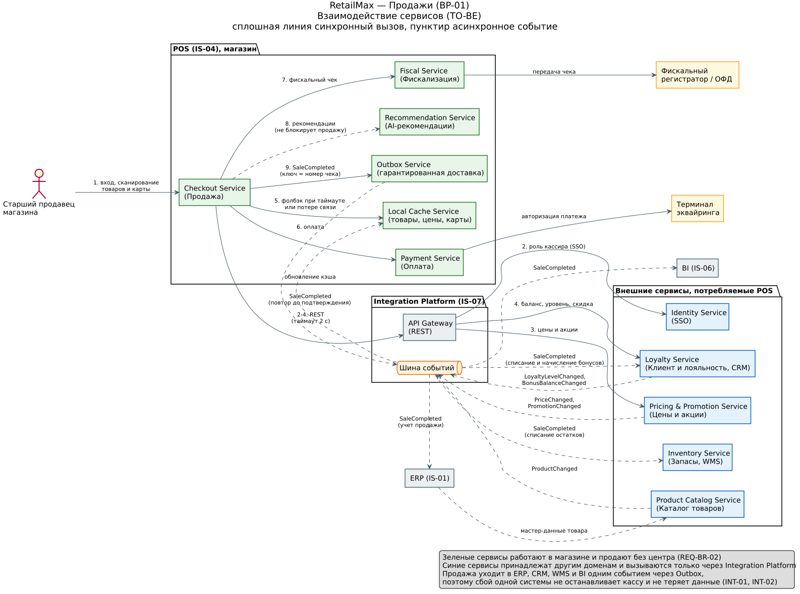

# Взаимодействие сервисов блока «Продажи» (BP-01)

| Поле | Значение |
| --- | --- |
| Целевая система | POS (IS-04) |
| Контекст | Оффлайн-продажи в розничных магазинах RetailMax |
| Состояние | TO-BE |
| Основа | [Каталог сервисов](../Services/SRV-sales-pos-catalog.md.md), [требования](../../01_Business_Architecture/Requirements/REQ-001-sales-requirements.md), DOC-05 |
| Автор | Савва (Application Architect) |

## 1. Принципы взаимодействия

1. Сервисы POS работают в магазине и вызывают сервисы других доменов только через Integration Platform (IS-07). Прямых связей POS с CRM, ERP и WMS нет.
2. Синхронно вызывается только то, без чего нельзя закрыть чек сейчас: роль кассира, цены и акции, баланс и скидка по карте, оплата, фискализация.
3. Каждый синхронный вызов в центр ограничен таймаутом 2 секунды. При таймауте или потере связи Checkout Service берет данные из Local Cache Service, продажа не останавливается (REQ-BR-02, INT-02).
4. Факт продажи передается одним событием SaleCompleted через Outbox Service. Событие повторяется до подтверждения, ключ идемпотентности равен номеру чека, поэтому данные не теряются и не задваиваются (INT-01).
5. Изменения справочников и данных клиента приходят на кассу событиями и обновляют локальный кэш.
6. AI-рекомендации вызываются асинхронно и не входят в критичный контур продажи (REQ-AI-01).

## 2. Диаграмма

Исходник PlantUML лежит рядом, файл `sales_services_interaction.puml`.

## 3. Синхронные взаимодействия

| № | Источник | Получатель | Что передается | Канал | Поведение при сбое |
| --- | --- | --- | --- | --- | --- |
| 1 | Старший продавец | Checkout Service | вход, сканирование товаров и карты | UI кассы | нет |
| 2 | Checkout Service | Identity Service (SSO) | проверка роли кассира | REST через IP | работа по ранее выданному токену (REQ-SA-01) |
| 3 | Checkout Service | Pricing & Promotion Service | цены и правила акций по позициям чека | REST через IP, таймаут 2 с | цены и акции из Local Cache |
| 4 | Checkout Service | Loyalty Service | уровень, баланс, персональная скидка по карте | REST через IP, таймаут 2 с | уровень из Local Cache с пометкой «не подтверждено» |
| 5 | Checkout Service | Local Cache Service | товары, цены, данные карты | локальный вызов | нет, кэш всегда в магазине |
| 6 | Checkout Service | Payment Service, затем терминал | сумма и способ оплаты | локальный вызов | повтор оплаты другим способом |
| 7 | Checkout Service | Fiscal Service, затем ФР и ОФД | фискальный чек | локальный вызов | ФР хранит чек и передает в ОФД позже |

## 4. Асинхронные события

| Событие | Публикует | Подписчики | Назначение |
| --- | --- | --- | --- |
| SaleCompleted | Outbox Service (POS) | Loyalty Service, Inventory Service, ERP, BI | списание и начисление бонусов, списание остатков, учет продажи, аналитика |
| LoyaltyLevelChanged, BonusBalanceChanged | Loyalty Service (CRM) | Local Cache Service (POS) | актуальный уровень и баланс клиента на всех кассах |
| PriceChanged, PromotionChanged | Pricing & Promotion Service | Local Cache Service (POS) | единые цены и акции во всех каналах |
| ProductChanged | Product Catalog Service | Local Cache Service (POS) | актуальный каталог на кассе |
| RecommendationRequested | Checkout Service | Recommendation Service | подсказки сопутствующих товаров без задержки чека |

## 5. Матрица зависимостей

| Сервис | Вызывает синхронно | Публикует события | Подписан на события |
| --- | --- | --- | --- |
| Checkout Service | Identity, Pricing & Promotion, Loyalty, Local Cache, Payment, Fiscal | SaleCompleted (через Outbox), RecommendationRequested | нет |
| Payment Service | терминал эквайринга | нет | нет |
| Fiscal Service | фискальный регистратор | нет | нет |
| Local Cache Service | нет | нет | ProductChanged, PriceChanged, PromotionChanged, LoyaltyLevelChanged, BonusBalanceChanged |
| Outbox Service | нет | SaleCompleted | подтверждения доставки |
| Recommendation Service | AI-сервис персонализации | нет | RecommendationRequested |
| Loyalty Service | нет | LoyaltyLevelChanged, BonusBalanceChanged | SaleCompleted |
| Inventory Service | нет | нет | SaleCompleted |
| Pricing & Promotion Service | нет | PriceChanged, PromotionChanged | нет |
| Product Catalog Service | нет | ProductChanged | мастер-данные из ERP |

## 6. Какие проблемы AS-IS это закрывает

| Проблема | Источник | Решение |
| --- | --- | --- |
| Время обслуживания растет при недоступности CRM | INT-02 | таймаут 2 с и локальный кэш карт |
| Нет повторной отправки продажи при ошибке | INT-01 | Outbox Service с повтором и ключом идемпотентности |
| Высокая зависимость кассы от центральных сервисов | BP-01, DOC-04 | локальные сервисы оплаты, фискализации и кэша |
| Отсутствует событийная интеграция | DOC-05, раздел 6 | шина событий Integration Platform |
| Часть систем связана напрямую | DOC-05, раздел 6 | все вызовы только через Integration Platform |
