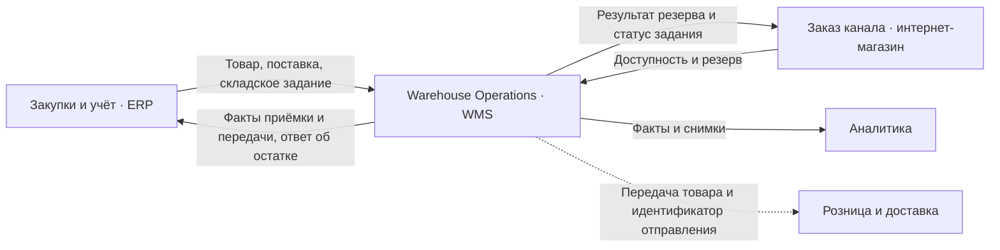

# Домены и ограниченные контексты Warehouse

## Граница модели

**Warehouse Operations** — предлагаемый Bounded Context центрального склада RetailMax. Владелец правил — логистика. WMS фиксирует складские факты и является источником центрального остатка. В контексте действуют общие определения количества, адреса хранения и статусов исполнения. Сервисы WH-SVC-01–04 используют эту модель внутри WMS, а адаптер WH-SVC-05 переводит контракты смежных систем через IS-07.

| Термин внутри Warehouse | Что означает и кто подтверждает |
| --- | --- |
| Остаток `Stock` | Количество SKU на центральном складе. Доступно = физический остаток − блокировки − резервы. |
| Резерв `Reservation` | WMS закрепила количество за заказом. Оплата и учётный заказ имеют собственные статусы в смежных контекстах. |
| Приёмка `Receipt` | Физически принятое количество и результат сверки. План поставки задаёт ERP. |
| Задание `FulfillmentTask` | Складская работа по подбору, упаковке и передаче. ERP выдаёт задание с идентификатором резерва. |
| Отгрузка `Shipment` | Подтверждённая физическая передача со склада. Доставку покупателю подтверждает служба доставки. |
| Инвентаризация `InventoryCount` | Пересчёт зоны. Корректировка применяется после утверждения начальником склада. |

## Карта контекстов

Стрелки показывают контракты и бизнес-стыки. Новый электронный обмен идёт через IS-07. Адаптер выполняет роль антикоррупционного слоя (ACL). Он преобразует внешние идентификаторы и статусы в команды склада. Бизнес-проверки выполняет WMS.

| Смежный контекст | Источник решения | Контракт на границе |
| --- | --- | --- |
| Закупки и учёт | ERP создаёт план поставки и учётный заказ | WMS получает план, выдаёт факт приёмки/передачи и отвечает на запрос текущего запаса. |
| Заказ канала | Интернет-магазин управляет клиентским заказом | WMS принимает запрос резерва. Канал связывает его с заказом по `orderId` и `reservationId`. |
| Аналитика | Аналитический контур строит показатели | WMS публикует версионированные факты и отдаёт стабильные снимки. |
| Розница и доставка | Владелец розницы или доставки подтверждает свой этап | Склад подтверждает передачу. Владелец магазинного остатка, сверка после потери связи и товар в пути остаются вопросами IF-05/06. |

[Каталог сервисов](WH-SRV-001-services.md) · [Контракты API и событий](../APIs/WH-API-001-catalog.md) · [Модель данных](../../03_Data_Architecture/Data_Entities/WH-DAT-001-data-model.md) · [Междоменные стыки](../../07_Project_Management/WH-PM-002-coordination.md)
