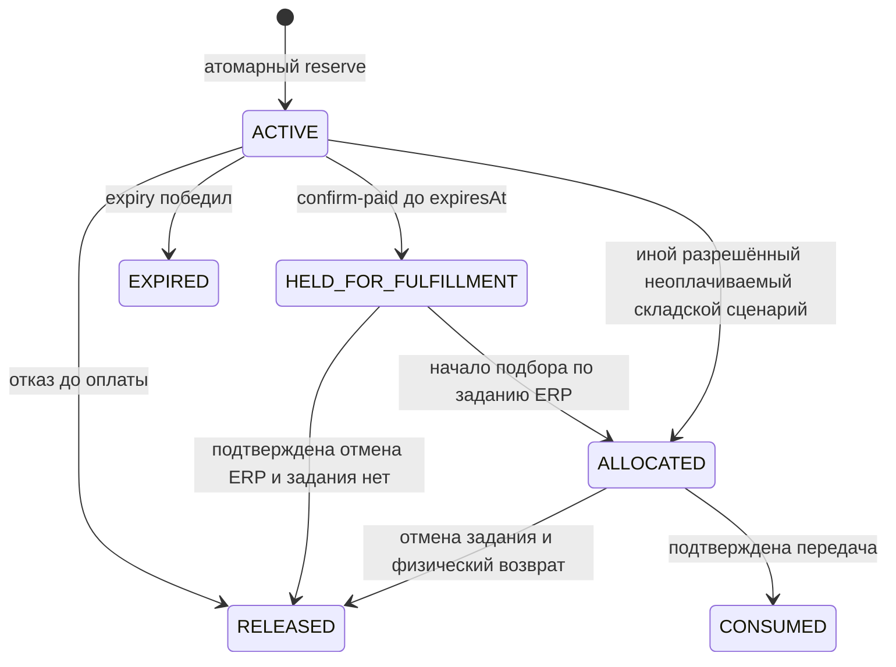

# Логическая модель данных и состояния Warehouse

| Поле | Значение |
| --- | --- |
| Идентификатор / версия | WH-DAT-001 / 1.3 |
| Дата | 12.11.2026 |
| Ответственная группа | Команда 3 — Warehouse |
| Статус | Проект для согласования |
| Источники | [DOC-03](../../../00_Documentation/DOC-03.md), [DOC-04](../../../00_Documentation/DOC-04.md), [DOC-06](../../../00_Documentation/DOC-06.md), [DOC-15](../../../00_Documentation/DOC-15.md); [INT-001/1.3](../../../06_integration_architecture/INT-001-target-model.md) |
| Связанные требования | WH-R-01/03/04/05/09/21/22/23/24 — [каталог](../../01_Business_Architecture/Requirements/WH-REQ-001-requirements.md) |

## Идентификаторы и границы

Product, Order и Purchase используют глобальные ключи ERP/канала. Профиль CRM и бонусный счёт не реплицируются в WMS целиком. Подтверждённый запас хранится WMS по **locationId + productId**, где locationId обозначает площадку хранения CENTRAL или STORE. Прежний warehouseId сохраняется как совместимый ключ CENTRAL; для STORE обязателен storeId/locationId. Внутренняя адресная ячейка — binId, чтобы не смешивать её с межсистемной локацией.

| Сущность / ключ | Поля и ограничения | Писатель |
|---|---|---|
| Product / productId | sku, unitCode, sourceVersion; разрешённая проекция | ERP |
| StorageSite / locationId | locationType=CENTRAL/STORE, storeId для STORE | Логистика, система справочника согласуется |
| Bin / binId | locationId, zone, capacity, constraints | WMS |
| Stock / locationId+productId | onHand, blocked, reserved, available, version, asOf | WMS |
| BinBalance / binId+productId+condition | Сумма согласована с onHand; staging включён до передачи | WMS |
| Reservation / reservationId | orderId/version, warehouseId CENTRAL, state, expiresAt, paymentId, holdDeadline, version | WMS |
| Receipt / receiptId | purchaseId либо transferId, строки expected/accepted/rejected, movementIds | WMS; план из ERP |
| FulfillmentTask / taskId | erpOrderId, orderId/version, reservationId, state, version | WMS по команде ERP |
| Shipment / shipmentId | taskId, receiverRef, handedOverAt; уникальная передача | WMS |
| Transfer / transferId | from/toLocationId; planned/dispatched/received/inTransit, receiptIds | WMS; план ERP |
| StoreJournal / locationId+journalId | sourceSequence; неизменяемая последовательность первичных операций | Локальный Inventory |
| StoreMovement / movementId | journalId/sequence, тип, количество/единица, документ, saleId+lineId либо receiptId/returnId | Inventory фиксирует; WMS подтверждает |
| StoreSync / locationId | journalId, appliedThroughSequence, highestKnownLocalSequence, lastContactAt, checkedAt, status | WMS |
| ReconciliationCase / caseId | Причина, исходный факт, решение, согласовавший, компенсирующее движение | Логистика через WMS |
| InventoryCount / countId | Scope, snapshotVersion, counted/expected, approval/reason | WMS |
| Operation / clientId+type+key | requestHash и сохранённый бизнес-результат | WMS |
| OutboxEntry / eventId | aggregateId/type/version, payload, публикация | Транзакция владельца факта |

Физическая схема поставщика не задана; прямые правки чужой БД не предлагаются.

## Инварианты количества

`available = onHand − blocked − reserved`; величины неотрицательны, `blocked + reserved ≤ onHand`. Для CENTRAL reserved включает ACTIVE, HELD_FOR_FULFILLMENT и ALLOCATED. Перемещение в staging не высвобождает reserved и не уменьшает onHand. При передаче onHand и reserved уменьшаются совместно, reserve становится CONSUMED.

Для STORE подтверждённое количество WMS может отставать от физического состояния при отсутствии связи; это явно отмечает StoreSync. Противоречивый локальный факт сохраняется в ReconciliationCase до применения. Чтобы не скрыть отрицательный физический/учётный результат, WMS не обрезает его до нуля и не пропускает движение: блокирует дальнейшую автоматическую обработку затронутой локации/позиции до решения.

Локальное количество = подтверждённая основа снимка + подписанные дельты только неприменённых движений того же журнала. Граница снимка и appliedThroughSequence читаются атомарно. Общие версии Stock не являются sourceSequence: это разные порядки.

Transfer: `inTransit = dispatched − received − resolvedLoss`, где resolvedLoss — только утверждённый исход расхождения. План не меняет количество. Получить больше отправленного без оформленного расхождения нельзя. Передача CENTRAL → STORE не расходует STORE; последующая продажа STORE не расходует CENTRAL.

## Состояния резерва

confirm-paid и expiry сериализуются по версии. HELD не освобождается обычным TTL. Достижение holdDeadline вызывает разбор и компенсацию, а не безусловный release. Для онлайн оплаченного заказа начало подбора разрешено только из HELD. Переход ACTIVE → ALLOCATED сохранён для явно разрешённых иных заданий, не для обхода оплаты интернет-заказа.

## Состояния задания и синхронизации

CREATED → PICKING → PACKED → HANDED_OVER. Недостача → EXCEPTION. Отмена до передачи → CANCELLING → CANCELLED после возврата отобранного; из HANDED_OVER в CANCELLED перехода нет. Уникальность исполнения — orderId/orderVersion и границы проекта исполнения; план доставки не создаёт второе задание.

SYNCED означает свежий heartbeat и применение/сверку всех известных движений. LAGGING — известный хвост/пропуск; OFFLINE — истёк таймаут контакта; RECONCILIATION_REQUIRED — неразобранное противоречие. Новый heartbeat не снимает расхождение. Отсутствие продаж при исправном контакте не делает магазин OFFLINE. Смена journalId требует контролируемого переноса границ.

[К содержанию Warehouse](../../README.md)
