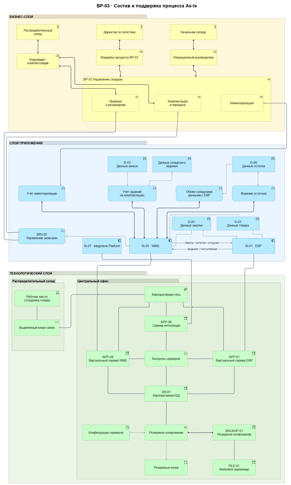
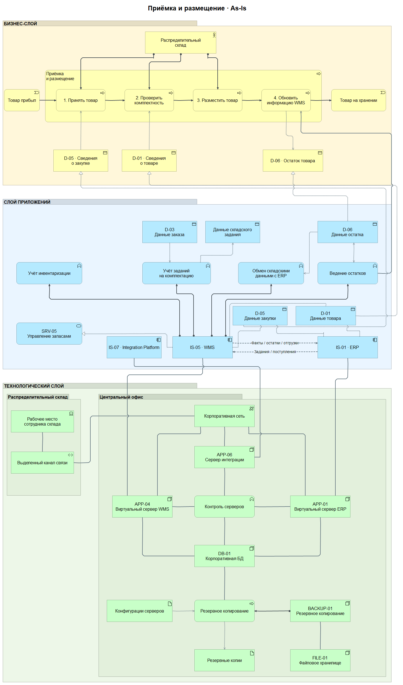

# ArchiMate As-Is: управление складом RetailMax

| Поле | Значение |
| --- | --- |
| Идентификатор / версия | WH-AM-001 / 2.0 |
| Дата | 23.11.2026 |
| Ответственная группа | Команда 3 — Warehouse |
| Автор редакции | SergeiKhlestunovHSE |
| Область | BP-03 «Управление складом», распределительный склад RetailMax |
| Состояние | As-Is |

[Модель для Archi](Warehouse.archimate) · [Open Exchange XML](WH-AM-001-model-exchange.xml) · [Связь с BPMN и требованиями](WH-AM-002-traceability.md).

## Назначение и состав

Модель показывает, кто выполняет складские операции, какие приложения и данные их поддерживают и от какой инфраструктуры зависит работа склада. В одном файле `Warehouse.archimate` находятся три представления. Общие приложения, данные и серверы имеют одни и те же идентификаторы; повторное отображение элемента на нескольких схемах не создаёт отдельную систему.

| Представление в папке Views | Содержание | Изображение |
| --- | --- | --- |
| 01 · BP-03 — состав и архитектура As-Is | Состав процесса, акторы и роли, прикладная и технологическая поддержка | [Обзор BP-03](views/bp-03-as-is.png) |
| 02 · Приёмка и размещение — As-Is | Приёмка поставки, проверка, размещение, обновление WMS | [Приёмка и размещение](views/receiving-as-is.png) |
| 03 · Комплектация и передача — As-Is | Формирование задания, подбор, упаковка, передача и уведомление ERP | [Комплектация и передача](views/fulfillment-as-is.png) |

Чтобы редактировать модель, откройте `Warehouse.archimate` через **File → Open** в Archi и выберите представление в **Views**. Изображения ниже экспортированы из этого файла. Open Exchange XML предназначен для импорта через **File → Import → Open Exchange XML Model**.

Основа работы — задание к [главе 3 курса](https://drive.google.com/file/d/1GnF4w1KmlS50Qp8-E892o9n3gNXipgVf/view), слайды 10–18: выбрать бизнес-процесс, построить BPMN As-Is, определить информационные системы, построить ArchiMate As-Is и связать модели. Здесь выбран BP-03; использованы существующие [BPMN As-Is](../BPMN/WH-BPMN-001-as-is.md), а соответствие операций и требований приведено в [таблицах трассировки](WH-AM-002-traceability.md). Хранение результата в папке своего домена соответствует [общей инструкции курса](https://drive.google.com/file/d/12PgTN5ehS3BMBwzvc1VbiklfN8FcEptI/view).

## 1. BP-03: состав и архитектура As-Is

BP-03 включает приёмку и размещение, комплектацию и передачу, инвентаризацию. Вложение подпроцессов показывает **Composition**, то есть состав. Порядок работы раскрыт на подробных представлениях. Между приёмкой и комплектацией нет обязательной последовательности: у них разные события запуска.

Директор по логистике выполняет роль владельца процесса BP-03; начальник склада — роль операционного руководителя. Распределительный склад показан как Business Actor, а кладовщик / комплектовщик — как Business Role, выполняющая приёмку и комплектацию. Назначение акторов на роли и ролей на процессы показано связями **Assignment**. Основание — [DOC-02](../../../00_Documentation/DOC-02.md), [DOC-03](../../../00_Documentation/DOC-03.md) и [паспорт BP-03](../../01_Business_Architecture/Business_Process/WH-BP-001-process.md).

Инвентаризация выполняется раз в квартал по [DOC-10](../../../00_Documentation/DOC-10.md). На обзоре это отдельный Business Process с поддержкой функции WMS «Учёт инвентаризации». Подробный текущий регламент источниками не раскрыт, поэтому порядок её операций не добавлен.

## 2. Приёмка и размещение

Последовательность: **товар прибыл → принять товар → проверить комплектность → разместить товар → обновить информацию WMS → товар на хранении**. Приёмка, проверка и размещение назначены Business Actor «Распределительный склад». В BPMN их выполняет кладовщик / комплектовщик. Размещение остаётся ручным — наличие функции WMS не означает автоматизацию физической работы.

Приёмка использует сведения о закупке D-05, проверка — сведения о товаре D-01. Обновление WMS изменяет сведения об остатке D-06 и поддерживается функцией «Ведение остатков». Связи **Realization** показывают соответствие электронных Data Object бизнес-объектам. Состав четырёх операций в подпроцессе показан вложением; **Triggering** связывает события и действия в последовательность.

[Исходник BPMN приёмки](../BPMN/WH-BPMN-ASIS-receiving.bpmn) · [Описание процесса](../BPMN/WH-BPMN-001-as-is.md#приёмка-и-размещение).

## 3. Комплектация и передача

Последовательность: **заказ поступил → сформировать задание → собрать заказ → упаковать заказ → передать магазину / доставке → передать изменение запасов ERP → исполнение завершено**. Подбор выполняется без оптимизации маршрута, как в BPMN As-Is. Сборка, упаковка и передача назначены Business Actor «Распределительный склад».

Функция «Учёт заданий на комплектацию» поддерживает формирование задания: читает данные заказа D-03 и создаёт данные складского задания. Подбор использует это задание. Функция «Обмен складскими данными с ERP» поддерживает передачу изменения запасов. Доставка после передачи и внутренние операции магазина находятся за границей процесса.

[Исходник BPMN комплектации](../BPMN/WH-BPMN-ASIS-fulfillment.bpmn) · [Описание процесса](../BPMN/WH-BPMN-001-as-is.md#комплектация-и-передача).

## Прикладной слой As-Is

Синий слой одинаков во всех трёх представлениях. Он содержит IS-05 WMS, IS-01 ERP, IS-07 Integration Platform, сервис SRV-05 «Управление запасами», четыре функции WMS и используемые объекты данных. Основание — [DOC-04](../../../00_Documentation/DOC-04.md), [DOC-06](../../../00_Documentation/DOC-06.md), [DOC-15](../../../00_Documentation/DOC-15.md).

| Функция WMS | Поддерживаемая операция | Доступ к данным |
| --- | --- | --- |
| Ведение остатков | Обновить информацию WMS | Чтение и запись D-06 |
| Учёт заданий на комплектацию | Сформировать задание | Чтение D-03, запись складского задания |
| Обмен складскими данными с ERP | Передать изменение запасов ERP | Чтение D-06 |
| Учёт инвентаризации | Инвентаризация в составе BP-03 | Подробные операции и данные инвентаризации не раскрыты |

WMS выполняет функции через **Assignment** и реализует SRV-05 через **Realization**. SRV-05 поддерживает подпроцессы приёмки и комплектации, а функции поддерживают конкретные операции связями **Serving**. Это существующая прикладная поддержка; степень автоматизации задач «обновить WMS» и «сформировать задание» в BPMN не уточнена.

| Data Object | Значение и связь с приложениями |
| --- | --- |
| D-01 · Данные товара | Основная система — ERP; данные используются ERP и WMS |
| D-05 · Данные закупки | Сведения о заказе поставщику; основная система — ERP; используются ERP и WMS |
| D-03 · Данные заказа | Вход для формирования складского задания |
| Данные складского задания | Результат формирования задания и основание для подбора |
| D-06 · Данные остатка | Складской остаток, с которым работают функции учёта и обмена WMS |

Для D-01 и D-05 показаны четыре связи **Access** от ERP и WMS. DOC-06 подтверждает использование данных, но не определяет режим каждой операции, поэтому эти связи оставлены без уточнения чтения / записи. Такой доступ не означает, что WMS является основной системой закупок или товарного каталога.

Потоки **ERP → WMS** («Задания / поступления») и **WMS → ERP** («Факты / остатки / отгрузки») показывают логический обмен. [DOC-05](../../../00_Documentation/DOC-05.md) описывает REST API, а [DOC-16](../../../00_Documentation/DOC-16.md) — также файловую передачу по расписанию. IS-07 присутствует в текущем ландшафте, но прохождение каждого обмена ERP–WMS именно через неё не установлено. Поэтому модель не задаёт неподтверждённый транзитный маршрут.

## Технологический слой As-Is

Зелёный слой показывает общую инфраструктуру по [DOC-07](../../../00_Documentation/DOC-07.md). Рабочее место сотрудника находится на распределительном складе. Выделенный канал связывает склад с корпоративной сетью центрального офиса, где размещены серверные ресурсы.

| Элементы | Назначение в модели |
| --- | --- |
| APP-04, APP-01, APP-06 | Виртуальные серверы WMS, ERP и Integration Platform; соответствие приложениям показано Association |
| DB-01 | Корпоративная БД, связанная с серверами WMS и ERP |
| Рабочее место, выделенный канал, корпоративная сеть | Среда доступа сотрудника склада к информационным системам |
| Контроль серверов | Контроль ресурсов средствами ОС для APP-04, APP-01, APP-06 и DB-01 |
| BACKUP-01, резервное копирование | Средство и процесс резервного копирования; BACKUP-01 назначен на процесс через Assignment |
| FILE-01 | Файловое хранилище, связанное с резервным копированием |
| Конфигурации серверов, резервные копии | Artifact: вход и результат процесса копирования |

Копирование выполняется ежедневно; в DOC-07 перечислены БД, файловое хранилище и конфигурации серверов. Проверка восстановления нерегулярна. Связи инфраструктуры показывают эксплуатационные зависимости, а не порядок складских операций. Тип рабочего терминала, конкретные ОС, СУБД и версия WMS в этих представлениях не определены. Действующий контроль ресурсов сервера не приравнивается к централизованному мониторингу приложений.

## Как читать отношения

| Отношение | Смысл на этих схемах |
| --- | --- |
| Assignment | Актор выполняет роль или действие; роль выполняет процесс; приложение выполняет функцию |
| Composition | Вложенные операции входят в состав процесса; обязательная последовательность из вложения не следует |
| Triggering | Переход от события или действия к следующему в подробном процессе |
| Serving | Прикладная функция или сервис поддерживает бизнес-процесс |
| Realization | WMS реализует сервис; электронные данные реализуют бизнес-объект |
| Access | Чтение, запись, чтение / запись либо доступ без уточнения режима |
| Flow | Передача информации между ERP и WMS |
| Association | Соответствие приложения серверу и инфраструктурная зависимость без детализации механизма |

## Границы описания

Это нормальные потоки текущего состояния. Обработка недостачи, отмены заказа, правила корректировки при инвентаризации и механизмы восстановления обменов здесь не спроектированы заново. Ограничения текущей работы — ручное размещение, отсутствие оптимизации подбора и расхождения остатков — служат основанием для [требований](../../01_Business_Architecture/Requirements/WH-REQ-001-requirements.md). Целевые процессы рассматриваются в [BPMN To-Be](../BPMN/WH-BPMN-002-to-be.md), а решения по изменению систем — в [ADR](../../05_Architecture_Decisions/ADR). Три опубликованных представления ArchiMate фиксируют As-Is.

[К содержанию Warehouse](../../README.md)
