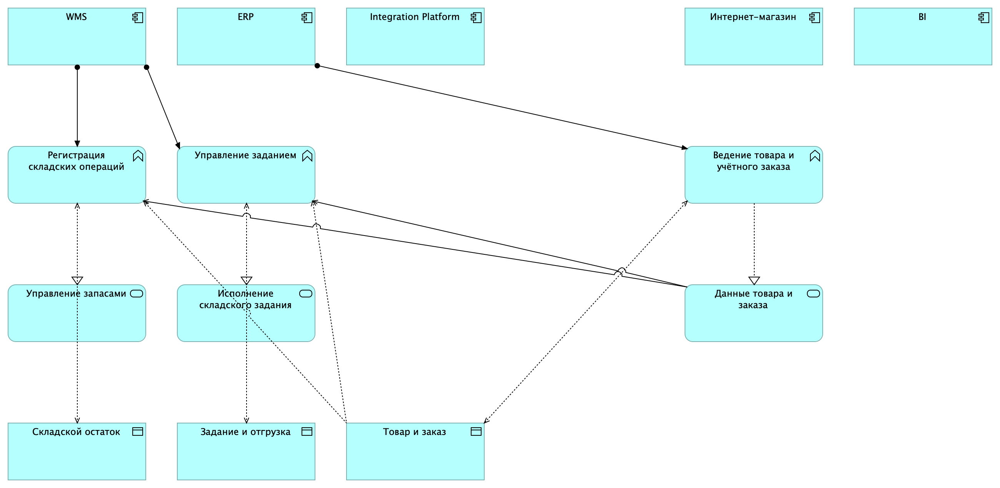
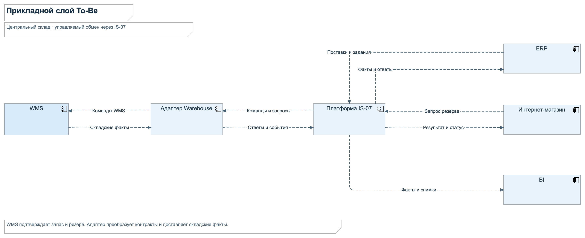
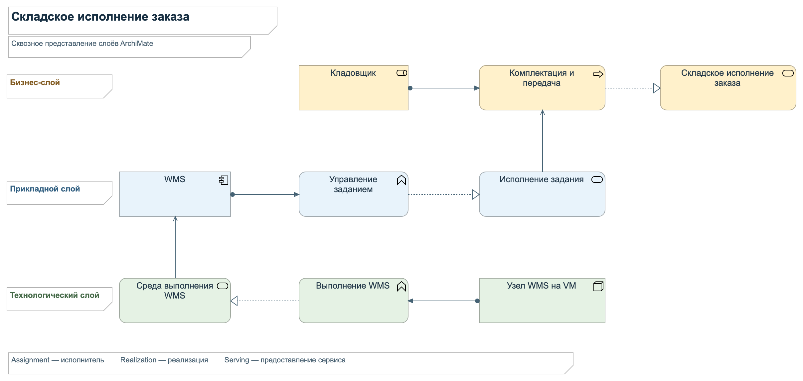
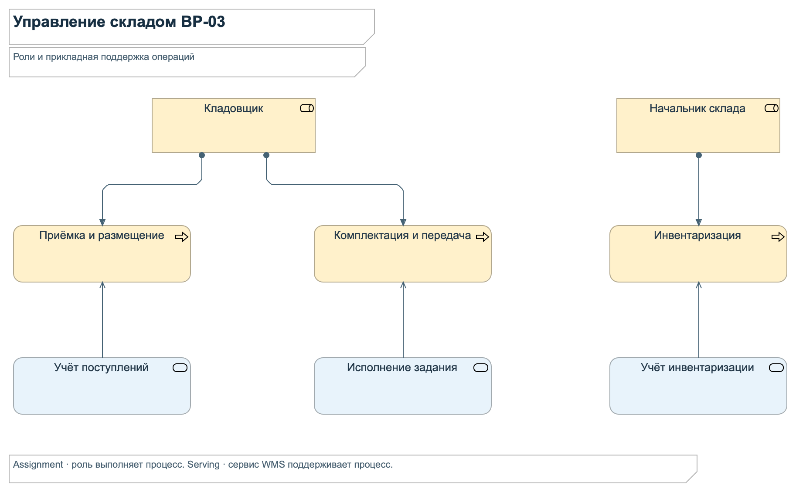
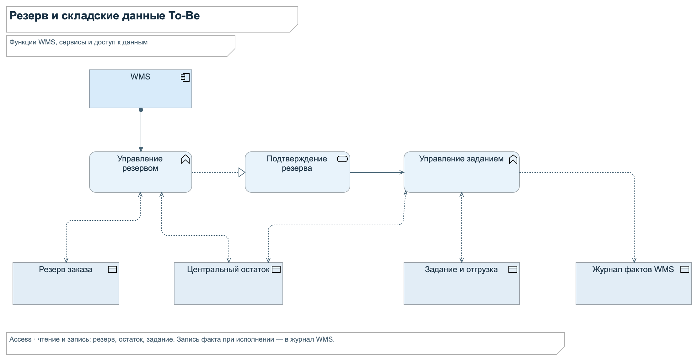
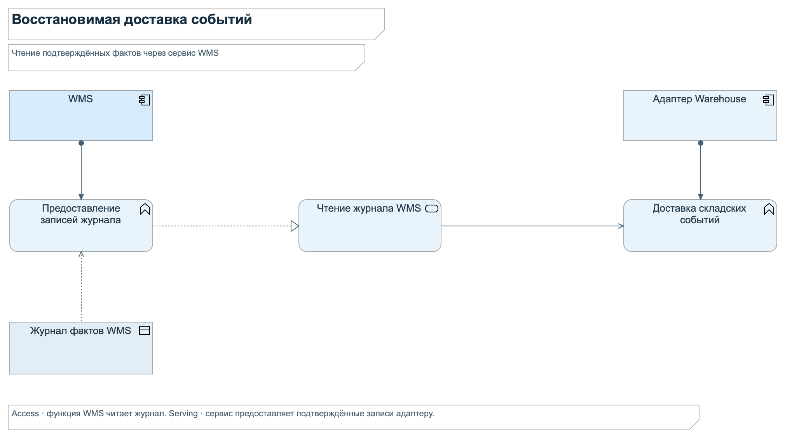

# ArchiMate центрального склада RetailMax

Модель BP-03 показывает текущий обмен приложений и целевую поддержку складских операций. Граница модели — центральный склад. Детали магазинного запаса и офлайн-сверки рассматриваются на [междоменных стыках](../../07_Project_Management/WH-PM-002-coordination.md).

[Модель Warehouse.archimate](Warehouse.archimate) · [Open Exchange XML](WH-AM-001-model-exchange.xml)

В Archi откройте папку **Views**. Изображения ниже экспортированы из тех же представлений.

## Прикладной слой As-Is

ERP и WMS обмениваются поставками, заданиями, остатками и фактами операций. Интернет-магазин получает каталог и остатки из ERP и передаёт заказы. BI получает данные из ERP раз в сутки. Представление построено по INT-03, INT-05 и INT-06 из DOC-05. Для ERP–WMS DOC-05 указывает REST, а DOC-16 описывает файловую передачу части справочных данных. Состав каналов уточняется при обследовании. [DOC-05](../../../00_Documentation/DOC-05.md) · [DOC-16](../../../00_Documentation/DOC-16.md)

## Прикладной слой To-Be

Запросы и команды проходят через IS-07 и складской адаптер. WMS подтверждает центральный остаток и резерв. В ERP поступают подтверждённые факты для учёта и ответы на запросы остатка. Интернет-магазин получает результат резерва и статус исполнения. BI получает факты и снимки. [Каталог интеграций](../../02_Application_Architecture/Integrations/WH-INT-001-integration.md) · [C4 Container](../C4/WH-C4-002-containers.md)

## Сквозное представление слоёв

Кладовщик выполняет комплектацию и передачу. Этот процесс реализует бизнес-сервис складского исполнения. WMS выполняет прикладную функцию управления заданием, которая реализует сервис для бизнес-процесса. Технологическая функция на узле WMS реализует среду выполнения приложения. [Паспорт BP-03](../../01_Business_Architecture/Business_Process/WH-BP-001-process.md) · [Развёртывание](../../04_Technology_Architecture/Deployment/WH-TECH-002-to-be.md)

## Роли и операции BP-03

Представление показывает ответственность кладовщика и начальника склада и прикладную поддержку приёмки, комплектации и инвентаризации. Порядок шагов и исключения раскрыты в [BPMN To-Be](../BPMN/WH-BPMN-002-to-be.md).

## Резерв и складские данные

Управление резервом читает и изменяет остаток и резерв заказа. Управление заданием работает с остатком, заданием и отгрузкой, а также фиксирует факт в журнале. Сервис подтверждения резерва используется функцией исполнения. [Модель данных](../../03_Data_Architecture/Data_Entities/WH-DAT-001-data-model.md) · [UML последовательности](../UML/WH-UML-001-components.md#последовательность-резерва-и-передачи)

## Восстановимая доставка событий

Функция WMS читает журнал и реализует сервис доступа к подтверждённым фактам. Адаптер использует этот сервис для доставки событий. Способ чтения журнала и восстановление после сбоя проверяются с поставщиком WMS. [ADR-WH-002](../../05_Architecture_Decisions/ADR/ADR-WH-002-integration.md)

## Обозначения

| Отношение | Как читать |
| --- | --- |
| **Assignment** | Роль выполняет процесс, приложение выполняет функцию, узел выполняет технологическую функцию. |
| **Realization** | Процесс или функция реализует сервис. Пунктирная линия с полым треугольником. |
| **Serving** | Сервис предоставляется потребителю. Стрелка направлена от сервиса к потребителю. |
| **Flow** | Передача информации между приложениями. Пунктирная стрелка указывает направление. |
| **Access** | Доступ функции к объекту данных. Направление наконечника показывает чтение или запись. Два наконечника означают чтение и запись. |

Все 39 отношений проверены по матрице допустимых связей ArchiMate 3.2 в Archi. Open Exchange XML прошёл проверку схемы и импорт в Archi. [Документация Archi](https://www.archimatetool.com/downloads/archi/Archi%20User%20Guide.pdf)

[К содержанию Warehouse](../../README.md)
