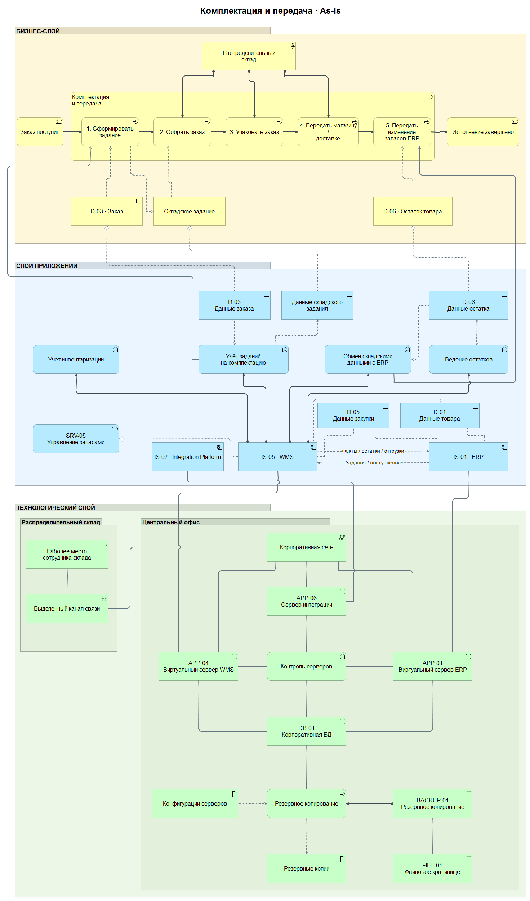

# ArchiMate As-Is: управление складом RetailMax

| Поле | Значение |
| --- | --- |
| Идентификатор / версия | WH-AM-001 / 2.1 |
| Дата | 23.11.2026 |
| Ответственная группа | Команда 3 - Warehouse |
| Автор редакции | SergeiKhlestunovHSE |
| Область | BP-03 "Управление складом", распределительный склад RetailMax |
| Состояние | As-Is |

[Модель для Archi](Warehouse.archimate), [Open Exchange XML](WH-AM-001-model-exchange.xml), [Связь с BPMN и требованиями](WH-AM-002-traceability.md).

## Назначение и состав

Модель описывает работу распределительного склада RetailMax: приёмку, комплектацию и инвентаризацию, используемые системы и инфраструктуру. В файле `Warehouse.archimate` сохранены три представления. Приложения, данные и серверы у них общие.

| Представление в папке Views | Содержание | Изображение |
| --- | --- | --- |
| 01. BP-03. Состав и архитектура As-Is | Состав процесса, акторы и роли, прикладная и технологическая поддержка | [Обзор BP-03](views/bp-03-as-is.png) |
| 02. Приёмка и размещение As-Is | Приёмка поставки, проверка, размещение, обновление WMS | [Приёмка и размещение](views/receiving-as-is.png) |
| 03. Комплектация и передача As-Is | Формирование задания, подбор, упаковка, передача и уведомление ERP | [Комплектация и передача](views/fulfillment-as-is.png) |

Для редактирования используется `Warehouse.archimate`. PNG ниже экспортированы из его представлений. Для переноса модели в другие инструменты приложен Open Exchange XML.

Модели построены для BP-03 по существующим [BPMN As-Is](../BPMN/WH-BPMN-001-as-is.md). Соответствие операций и требований приведено в [таблицах трассировки](WH-AM-002-traceability.md). Порядок хранения файлов описан в [общей инструкции курса](https://drive.google.com/file/d/12PgTN5ehS3BMBwzvc1VbiklfN8FcEptI/view).

## 1. BP-03: состав и архитектура As-Is

BP-03 включает приёмку и размещение, комплектацию и передачу, инвентаризацию. Приёмка начинается с поступления товара. Комплектация начинается с поступления заказа. Это отдельные процессы. Порядок их операций показан на двух подробных схемах.

Директор по логистике является владельцем BP-03 и отвечает за процесс в целом. Начальник склада руководит текущей работой. Кладовщик / комплектовщик выполняет приёмку и комплектацию. На обзоре эти обязанности показаны через роли. Основание: [DOC-02](../../../00_Documentation/DOC-02.md), [DOC-03](../../../00_Documentation/DOC-03.md) и [паспорт BP-03](../../01_Business_Architecture/Business_Process/WH-BP-001-process.md).

Инвентаризация выполняется раз в квартал по [DOC-10](../../../00_Documentation/DOC-10.md). Её поддерживает функция WMS "Учёт инвентаризации". В документах нет подробного текущего регламента, поэтому на обзоре указан процесс без разбивки на операции.

## 2. Приёмка и размещение

После прибытия товара выполняются четыре операции:

1. Принять товар.
2. Проверить комплектность.
3. Разместить товар.
4. Обновить информацию WMS.

Процесс заканчивается размещением товара на хранении. Приёмку, проверку и размещение выполняет кладовщик / комплектовщик. В ArchiMate исполнителем указан распределительный склад. Размещение выполняется вручную.

При приёмке используются сведения о закупке D-05. Для проверки комплектности нужны сведения о товаре D-01. Обновление WMS изменяет остаток D-06. Эту операцию поддерживает функция "Ведение остатков".

[Исходник BPMN приёмки](../BPMN/WH-BPMN-ASIS-receiving.bpmn), [Описание процесса](../BPMN/WH-BPMN-001-as-is.md#приёмка-и-размещение).

## 3. Комплектация и передача

После поступления заказа выполняются пять операций:

1. Сформировать задание.
2. Собрать заказ.
3. Упаковать заказ.
4. Передать магазину / доставке.
5. Передать изменение запасов ERP.

После передачи изменения в ERP исполнение завершается. Подбор выполняется без оптимизации маршрута, как в BPMN As-Is. Сборку, упаковку и передачу выполняет кладовщик / комплектовщик. В ArchiMate эти действия назначены распределительному складу.

Функция "Учёт заданий на комплектацию" читает данные заказа D-03 и создаёт складское задание. По нему сотрудник собирает заказ. Функция "Обмен складскими данными с ERP" обеспечивает передачу изменения запасов. Дальнейшая доставка и работа магазина в модель не входят.

[Исходник BPMN комплектации](../BPMN/WH-BPMN-ASIS-fulfillment.bpmn), [Описание процесса](../BPMN/WH-BPMN-001-as-is.md#комплектация-и-передача).

## Прикладной слой As-Is

Синий слой одинаков во всех трёх представлениях. На нём показаны IS-05 WMS, IS-01 ERP, IS-07 Integration Platform, сервис SRV-05 "Управление запасами", четыре функции WMS и используемые данные. Источники: [DOC-04](../../../00_Documentation/DOC-04.md), [DOC-06](../../../00_Documentation/DOC-06.md), [DOC-15](../../../00_Documentation/DOC-15.md).

| Функция WMS | Поддерживаемая операция | Доступ к данным |
| --- | --- | --- |
| Ведение остатков | Обновить информацию WMS | Чтение и запись D-06 |
| Учёт заданий на комплектацию | Сформировать задание | Чтение D-03, запись складского задания |
| Обмен складскими данными с ERP | Передать изменение запасов ERP | Чтение D-06 |
| Учёт инвентаризации | Инвентаризация в составе BP-03 | Подробные операции и данные инвентаризации не раскрыты |

WMS предоставляет сервис SRV-05 для приёмки и комплектации. Связи четырёх функций с операциями показаны на соответствующих схемах. Степень автоматизации обновления WMS и формирования задания в исходных BPMN не уточнена.

| Данные | Использование |
| --- | --- |
| D-01. Данные товара | Основная система ERP. Данные используются ERP и WMS |
| D-05. Данные закупки | Сведения о заказе поставщику. Основная система ERP. Данные также используются WMS |
| D-03. Данные заказа | Вход для формирования складского задания |
| Данные складского задания | Результат формирования задания и основание для подбора |
| D-06. Данные остатка | Складской остаток, с которым работают функции учёта и обмена WMS |

ERP и WMS используют данные товара D-01 и закупки D-05. В DOC-06 не указаны режимы чтения и записи для каждой системы, поэтому в модели они не уточняются. Основной системой для обоих объектов остаётся ERP.

ERP передаёт в WMS задания и сведения о поступлениях. WMS возвращает факты операций, остатки и сведения об отгрузках. В [DOC-05](../../../00_Documentation/DOC-05.md) описан REST API, в [DOC-16](../../../00_Documentation/DOC-16.md) также упомянута файловая передача по расписанию. Точный маршрут обмена через IS-07 требует уточнения.

## Технологический слой As-Is

Зелёный слой показывает общую инфраструктуру по [DOC-07](../../../00_Documentation/DOC-07.md). Рабочее место сотрудника находится на распределительном складе. Выделенный канал связывает склад с корпоративной сетью центрального офиса, где размещены серверные ресурсы.

| Элементы | Назначение в модели |
| --- | --- |
| APP-04, APP-01, APP-06 | Виртуальные серверы WMS, ERP и Integration Platform |
| DB-01 | Корпоративная БД, связанная с серверами WMS и ERP |
| Рабочее место, выделенный канал, корпоративная сеть | Среда доступа сотрудника склада к информационным системам |
| Контроль серверов | Контроль ресурсов средствами ОС для APP-04, APP-01, APP-06 и DB-01 |
| BACKUP-01, резервное копирование | Сервер и процесс резервного копирования |
| FILE-01 | Файловое хранилище, связанное с резервным копированием |
| Конфигурации серверов, резервные копии | Конфигурации читаются при копировании, резервные копии содержат результат |

Ежедневно копируются БД, файловое хранилище и конфигурации серверов. Восстановление из копий проверяется нерегулярно. В модели не уточняются тип рабочего терминала, ОС, СУБД и версия WMS. Серверы контролируются средствами ОС; централизованного мониторинга приложений нет.

## Границы описания

В моделях рассмотрен обычный ход приёмки и исполнения заказа. Недостача, отмена заказа, порядок инвентаризационных корректировок и восстановление обменов здесь не детализированы. Ручное размещение, отсутствие оптимизации подбора и расхождения остатков учтены в [требованиях](../../01_Business_Architecture/Requirements/WH-REQ-001-requirements.md). Целевые процессы описаны в [BPMN To-Be](../BPMN/WH-BPMN-002-to-be.md). Решения по изменению систем приведены в [ADR](../../05_Architecture_Decisions/ADR).

[К содержанию Warehouse](../../README.md)
