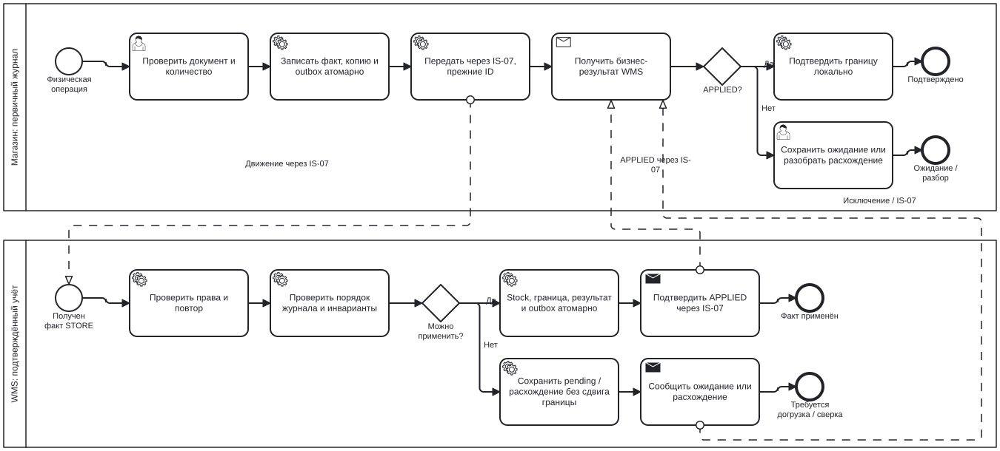

# BPMN целевых складских процессов

| Поле | Значение |
| --- | --- |
| Идентификатор / версия | WH-BPMN-002 / 1.3 |
| Дата | 12.11.2026 |
| Ответственная группа | Команда 3 — Warehouse |
| Статус | Проект для согласования |
| Источники | [DOC-03](../../../00_Documentation/DOC-03.md), [DOC-04](../../../00_Documentation/DOC-04.md), [DOC-05](../../../00_Documentation/DOC-05.md), [DOC-06](../../../00_Documentation/DOC-06.md), [DOC-08](../../../00_Documentation/DOC-08.md); [INT-001/1.3](../../../06_integration_architecture/INT-001-target-model.md) |
| Связанные требования | WH-R-03/04/05/09/21/22/23/24 — [каталог](../../01_Business_Architecture/Requirements/WH-REQ-001-requirements.md) |

As-Is сохраняется отдельно и не получает целевого журнала магазина и удержания оплаченного резерва. To-Be включает независимые процессы приёмки, исполнения, инвентаризации и STORE-движений. Связи между пулами — сообщения, физическая передача показана задачей исполнителя.

| Процесс | Просмотр | Исходник |
|---|---|---|
| Приёмка CENTRAL | [SVG](WH-BPMN-TOBE-receiving.svg) | [BPMN](WH-BPMN-TOBE-receiving.bpmn) |
| Исполнение по заданию ERP | [SVG](WH-BPMN-TOBE-fulfillment.svg) | [BPMN](WH-BPMN-TOBE-fulfillment.bpmn) |
| Инвентаризация | [SVG](WH-BPMN-TOBE-count.svg) | [BPMN](WH-BPMN-TOBE-count.bpmn) |
| Движение STORE и применение WMS | [SVG](WH-BPMN-TOBE-store.svg) | [BPMN](WH-BPMN-TOBE-store.bpmn) |

STORE-схема начинается с уже разрешённой физической операции. Если связи нет, локальный журнал/outbox сохраняет поручение, а доставка ждёт восстановления; это не разрешение повторить физическую продажу. Задача передачи через IS-07 включает технические повторы с прежними ID. Ветка «Нет» сохраняет ожидающий факт или расхождение и завершает текущую попытку, не бизнес-обязательство. После догрузки/разбора продолжается тот же факт по прежнему ID. Повтор APPLIED возвращает прежний результат.

В исполнении проверяются reserve, версия заказа и единственный источник задания ERP. Для оплаченного онлайн-заказа требуется HELD_FOR_FULFILLMENT; RESERVED по ответу брокера недостаточно. Подбор переводит резерв в ALLOCATED; передача фиксирует Stock/Reserve/Task и outbox совместно. Отмена до подбора освобождает разрешённый reserve; во время подбора требует физического возврата, после передачи — нового процесса возврата.

Приёмка регистрирует только принятое количество. Инвентаризация ограничивает конкретную зону и требует утверждения; неутверждённая корректировка не считается выполненной. Пополнение CENTRAL→STORE подробно представлено в [Sequence SC-WH-04](../UML/WH-SEQ-004-store-transfer.svg): план не движение, частичная приёмка сохраняет путь/расхождение.

## Связь изменений с проблемами и требованиями

| Проблема / риск As-Is | Изменение процесса | Требования / проверка |
| --- | --- | --- |
| Ненадёжная доступность и повторное резервирование | Один резерв до оплаты, удержание после confirm-paid, задание только ERP с прежним reservationId | WH-R-03/05/24; QA-01/02/22/23 |
| Расхождения при приёмке и инвентаризации | Фиксировать фактически принятое количество, основание расхождения и утверждение корректировки | WH-R-04/14; BPMN receiving/count |
| Потеря или повтор движения магазина | Локальный журнал, повтор с прежними ID, непрерывное подтверждение WMS и разбор конфликта | WH-R-21/22; QA-15–19/21/24 |
| Неясная граница пополнения | Разделить план, отгрузку, путь и частичные приёмки | WH-R-23; QA-20 |

Бизнес-результат процесса подтверждается WMS; приём сообщения платформой не подтверждает изменение запаса. Такой порядок сохраняет различие между технической доставкой, физическим фактом и разрешённой учётной корректировкой.

[К содержанию Warehouse](../../README.md)
