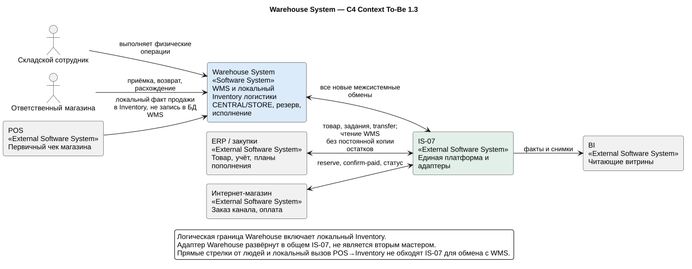

# C4 Context Warehouse System

| Поле | Значение |
| --- | --- |
| Идентификатор / версия | WH-C4-001 / 1.3 |
| Дата | 12.11.2026 |
| Ответственная группа | Команда 3 — Warehouse |
| Статус | Проект для согласования |
| Источники | [DOC-03](../../../00_Documentation/DOC-03.md), [DOC-04](../../../00_Documentation/DOC-04.md), [DOC-05](../../../00_Documentation/DOC-05.md), [DOC-09](../../../00_Documentation/DOC-09.md); [INT-001/1.3](../../../06_integration_architecture/INT-001-target-model.md); [лекция 4](https://drive.google.com/file/d/1AShDDsHBHSOAfTgPLr-UBiem6JnYv0xg/view) |
| Связанные требования | WH-R-01/02/03/17/21 — [каталог](../../01_Business_Architecture/Requirements/WH-REQ-001-requirements.md) |

Warehouse System — логическая граница WMS и локального Inventory логистики; это развитие существующих систем, а не новый продукт. Контекст показывает людей и внешние системы. Детали контейнеров здесь не смешиваются с бизнес-контекстом.

Исходники: [PlantUML](WH-C4-001-context.puml), [Structurizr DSL](workspace.dsl). Все новые внешние обмены идут через IS-07. POS даёт Inventory локальный факт чека, но не пишет напрямую в WMS/её БД. Финансовое отражение, цены, профиль клиента и бонусы остаются у ERP/CRM/каналов.

Привязка: BP-03; WH-R-01/02/03/21–24; ADR-WH-001/002/004. Граница CENTRAL/STORE — To-Be по общему пакету 1.3; не утверждение о существующем As-Is.

[К содержанию Warehouse](../../README.md)
