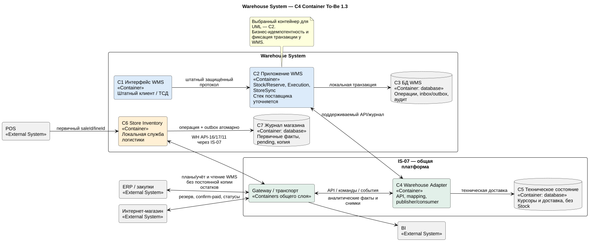

# C4 Container Warehouse и общий интеграционный слой

| Поле | Значение |
| --- | --- |
| Идентификатор / версия | WH-C4-002 / 1.3 |
| Дата | 12.11.2026 |
| Ответственная группа | Команда 3 — Warehouse |
| Статус | Проект для согласования |
| Источники | [DOC-04](../../../00_Documentation/DOC-04.md), [DOC-05](../../../00_Documentation/DOC-05.md), [DOC-07](../../../00_Documentation/DOC-07.md), [DOC-09](../../../00_Documentation/DOC-09.md); [INT-001/1.3](../../../06_integration_architecture/INT-001-target-model.md); [лекция 4](https://drive.google.com/file/d/1AShDDsHBHSOAfTgPLr-UBiem6JnYv0xg/view) |
| Связанные требования | WH-R-01/02/09/10/17/21/22 — [каталог](../../01_Business_Architecture/Requirements/WH-REQ-001-requirements.md) |

| ID | Контейнер | Данные / размещение |
|---|---|---|
| C1 | Интерфейс WMS | Штатный клиент/ТСД; не второй мастер |
| **C2** | **Приложение WMS** | Выбрано для UML Component/Sequence; поддерживаемые модули поставщика |
| C3 | БД WMS | Stock/Reserve/Task/Transfer/Inbox/Outbox/Audit в поддерживаемой транзакционной границе |
| C4 | Warehouse Adapter в IS-07 | API, consumer/publisher и сопоставление данных; без собственного Stock |
| C5 | Техническое состояние адаптера в IS-07 | Курсоры/доставка/карантин; не замена бизнес-идемпотентности C2 |
| C6 | Store Inventory | Служба логистики в магазине; локальные операции и синхронизация |
| C7 | Журнал магазина | Первичные движения, pending/outbox, оперативная копия; устойчивое хранилище |

WMS/ERP и их БД сохраняются на поддерживаемой инфраструктуре. Новые stateless-адаптеры размещаются на общем контейнерном контуре; Store Inventory должен переживать отсутствие WAN. Контейнер в модели C4 — приложение или хранилище, а не требование Docker для каждого блока.

Адаптеры относятся к общей IS-07; это уточняет октябрьскую схему, в которой адаптер был внутри рамки Warehouse System. Владение кодом/семантикой Warehouse не означает отдельную интеграционную платформу. Персональные исполнители и фактический стек определяются до реализации.

Исходники: [DSL](workspace.dsl), [PlantUML](WH-C4-002-containers.puml). [Детализация C2](../UML/WH-UML-001-components.md). Сетевая топология и HA — отдельная технологическая архитектура.

[К содержанию Warehouse](../../README.md)
