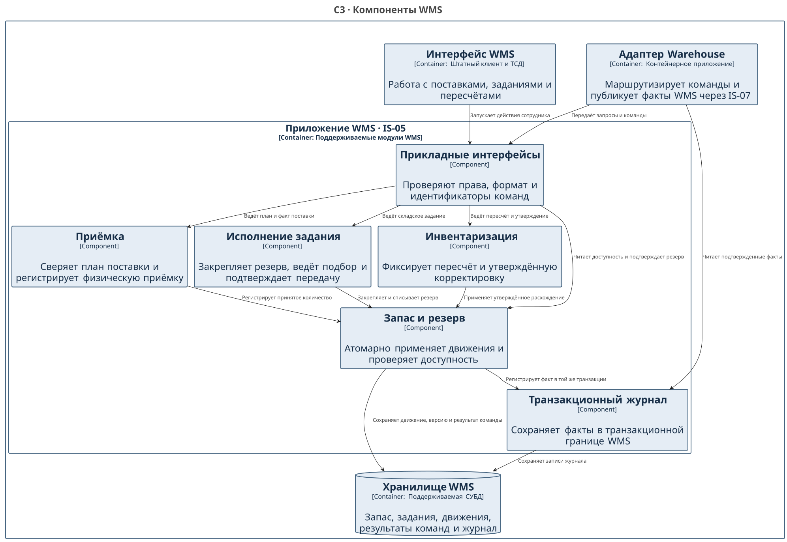

# C4 C3 · Компоненты WMS

Декомпозиция относится к приложению WMS на [уровне C2](WH-C4-002-containers.md). Поддержку этих модулей и интерфейсов необходимо подтвердить у поставщика.

[Исходник Structurizr](workspace.dsl), представление `WH-C3`.

| Компонент | Ответственность | Контракт |
| --- | --- | --- |
| Прикладные интерфейсы | Проверяют полномочия, формат и идентификаторы; направляют операцию в нужный модуль | Точка входа интерфейса WMS и складского адаптера |
| Запас и резерв | Проверяет доступность и атомарно применяет изменение запаса и резерва | WH API-01–03, WH-R-01/03 |
| Приёмка | Сверяет поставку и передаёт принятое количество в модуль запаса | WH API-04/05, WH-R-04 |
| Исполнение задания | Закрепляет резерв при подборе, регистрирует передачу и отмену | WH API-06–09, WH-R-05 |
| Инвентаризация | Ведёт пересчёт и передаёт утверждённую корректировку в модуль запаса | WH API-10, WH-R-04/14 |
| Транзакционный журнал | Сохраняет подтверждённые факты в транзакционной границе WMS; адаптер читает их через поддерживаемый интерфейс | WH-R-09, ADR-WH-002 |

См. [каталог API](../../02_Application_Architecture/APIs/WH-API-001-catalog.md), [ADR по доставке событий](../../05_Architecture_Decisions/ADR/ADR-WH-002-integration.md) и [UML](../UML/WH-UML-001-components.md).

[К содержанию Warehouse](../../README.md)
