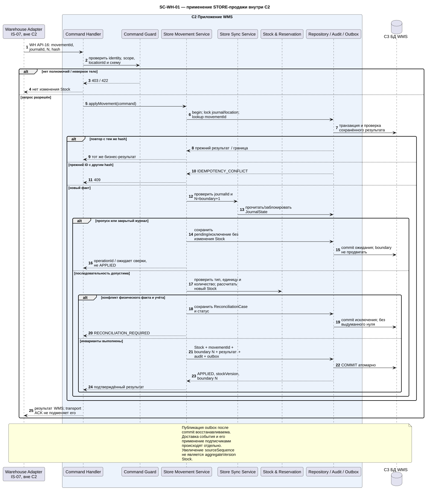

# UML Component и Sequence выбранного контейнера C2

| Поле | Значение |
| --- | --- |
| Идентификатор / версия | WH-UML-001 / 1.3 |
| Дата | 12.11.2026 |
| Ответственная группа | Команда 3 — Warehouse |
| Статус | Проект для согласования |
| Источники | [DOC-05](../../../00_Documentation/DOC-05.md), [DOC-09](../../../00_Documentation/DOC-09.md); [INT-001/1.3](../../../06_integration_architecture/INT-001-target-model.md); [лекция 4](https://drive.google.com/file/d/1AShDDsHBHSOAfTgPLr-UBiem6JnYv0xg/view) |
| Связанные требования | WH-R-01/03/05/09/21/22/23/24 — [каталог](../../01_Business_Architecture/Requirements/WH-REQ-001-requirements.md) |

## Выбранный контейнер и сценарий

Для практической работы главы 4, слайд 20, выбран **C2 «Приложение WMS»** из C4 Container. Внутри него находятся компоненты, а не отдельные Docker-сервисы. C3 БД WMS и адаптер IS-07 показаны внешними зависимостями. Имена одинаковы на обеих UML-диаграммах.

[Редактируемый PlantUML](WH-UML-001-components.puml).

| Компонент | Предоставляет | Использует |
|---|---|---|
| Command Handler | IWarehouseCommand | IGuard и прикладные интерфейсы |
| Command Guard | IGuard | Идентификацию клиента и бизнес-права |
| Store Movement Service | IStoreMovement | IStoreSync, IStock, ITransaction |
| Store Sync Service | IStoreSync | ITransaction |
| Stock & Reservation | IStock | ITransaction |
| Fulfillment & Transfer | IExecution | IStock, ITransaction |
| Receiving & Inventory Control | IReceiving | IStock, ITransaction |
| Repository / Audit / Outbox | ITransaction | C3 БД WMS |

## SC-WH-01: применение продажи STORE

Предусловие: Inventory магазина уже сохранил физический факт и доставляет команду через IS-07. Успех — одно APPLIED, Stock новой версии и непрерывная граница журнала. Транспортный ACK — не успех сценария.

[Исходник Sequence](WH-SEQ-001-store-components.puml). Показаны запрет доступа, повтор, конфликт hash, пропуск журнала, учётное противоречие и атомарный нормальный путь. Повтор не вызывает второй расход. Запись pending/расхождения сохраняет физический факт, но не поднимает appliedThroughSequence.

| BPMN | C4 / компонент | Данные / контракт | Проверка |
|---|---|---|---|
| STORE: локальная фиксация | C6 Store Inventory, вне C2 | StoreJournal + outbox | WH-QA-15/16 |
| STORE: валидация и дедупликация | C2 Command Handler/Guard, Store Movement | WH API-16, Operation | WH-QA-15/18 |
| STORE: порядок и применение | C2 Store Sync, Stock, Repository | Stock, JournalState, outbox | WH-QA-16/17/21 |
| STORE: результат для закупок | C4 адаптер IS-07, вне C2 | INT EVT-25/27 | WH-QA-19/22 |

## Межсистемные сценарии

| Сценарий | SVG | Исходник |
|---|---|---|
| SC-WH-02 Резерв, оплата и задание | [Просмотр](WH-SEQ-002-online-order.svg) | [PlantUML](WH-SEQ-002-online-order.puml) |
| SC-WH-03 Магазин и восстановление связи | [Просмотр](WH-SEQ-003-store-sync.svg) | [PlantUML](WH-SEQ-003-store-sync.puml) |
| SC-WH-04 Частичное пополнение | [Просмотр](WH-SEQ-004-store-transfer.svg) | [PlantUML](WH-SEQ-004-store-transfer.puml) |

Они дополняют внутренний SC-WH-01. Взята структура представления компонентов/участников из отдельных Sequence продаж и закупок; их бизнес-правила не копируются в Warehouse. Доказательство реальной поддержки транзакций WMS ещё требуется.

[К содержанию Warehouse](../../README.md)
