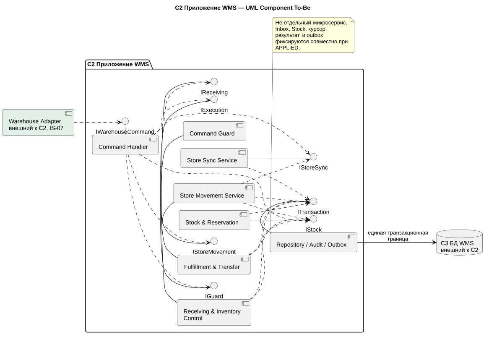
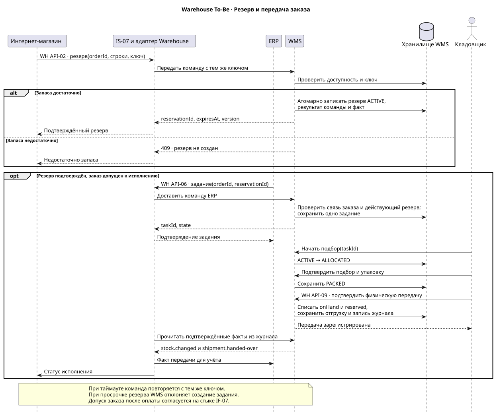

# UML Component: складское приложение и адаптер

| Поле | Значение |
| --- | --- |
| Идентификатор / версия | WH-UML-001 / 1.0 |
| Дата | 04.10.2026 |
| Ответственная группа | Команда 3 — Warehouse |
| Статус | Проект для согласования; не свидетельствует о внедрении |
| Источники | [DOC-05](../../../00_Documentation/DOC-05.md), [DOC-09](../../../00_Documentation/DOC-09.md) |
| Связанные требования | WH-R-01/02/03/09/18 — [каталог](../../01_Business_Architecture/Requirements/WH-REQ-001-requirements.md) |

## Компонентная модель To-Be

Компоненты детализируют приложение WMS и складской адаптер из [C4 C2](../C4/WH-C4-002-containers.md). Вызовы складских команд проходят через прикладные интерфейсы WMS. Приёмка, исполнение и инвентаризация используют один модуль изменения запаса. Адаптер переводит контракты и читает подтверждённые факты из журнала через поддерживаемый интерфейс.

[Исходник PlantUML](WH-UML-001-components.puml) · [Описание компонентов WMS](../C4/WH-C4-003-components.md)

## Последовательность резерва и передачи

Интернет-магазин получает результат резерва из WMS. ERP выдаёт задание с тем же `reservationId`. При старте подбора WMS закрепляет резерв. Подтверждение физической передачи фиксирует отгрузку, списание и событие в транзакционной границе WMS.

[Исходник PlantUML](WH-UML-002-reservation-sequence.puml) · [BPMN исполнения](../BPMN/WH-BPMN-002-to-be.md#исполнение-подтверждённый-резерв-и-контроль-результата) · [Каталог API](../../02_Application_Architecture/APIs/WH-API-001-catalog.md)

[К содержанию Warehouse](../../README.md)
