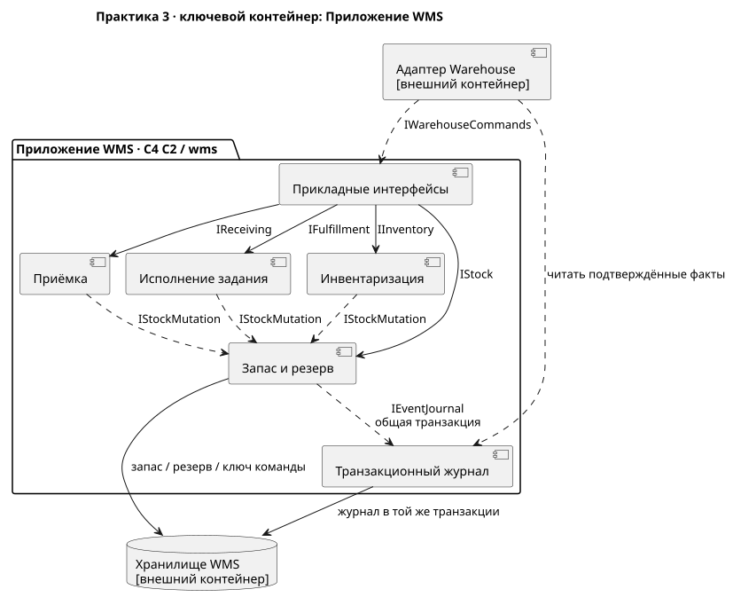
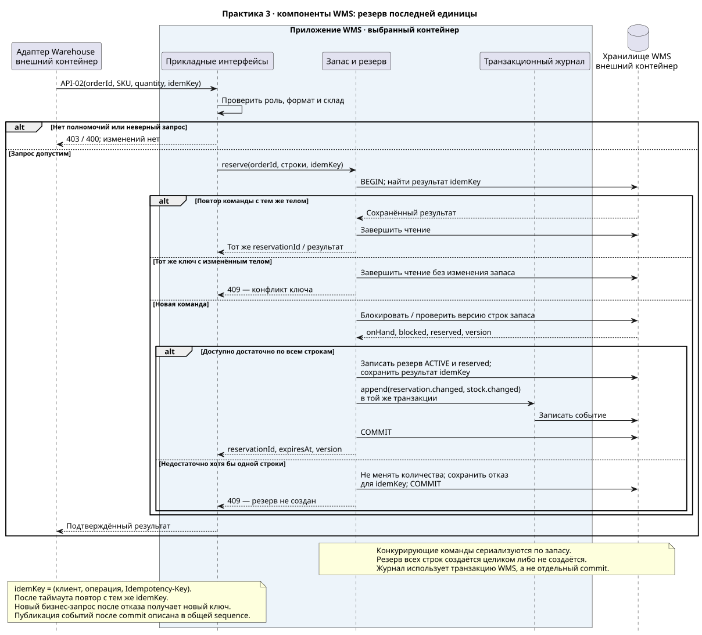

# Практика 3: детализация одного контейнера WMS

Дата: 26.11.2026. Статус: проект архитектуры, готов к представлению; не является результатом испытаний WMS.

## Выбранный контейнер и сценарий

Выбран **«Приложение WMS»**, идентификатор `wms` в [Structurizr DSL](../C4/workspace.dsl). Он соответствует приложению IS-05; клиент, БД и адаптер — отдельные контейнеры. Ключевой сценарий — **резерв последней единицы товара** (WH-R-03, API-02). Он конкретизирует уже существующий сценарий резерва и передачи, сохраняя единый источник запаса.

## UML Component

[Редактируемый PlantUML](WH-UML-003-wms-reservation.puml). Внутри границы ровно шесть компонентов из [C4 C3](../C4/WH-C4-003-components.md). Адаптер и хранилище изображены снаружи. Приёмка, исполнение и инвентаризация используют один интерфейс изменения запаса. `IStockMutation` — внутренний интерфейс; соседние системы его не вызывают.

## UML Sequence

[Редактируемый PlantUML](WH-UML-004-wms-reservation-sequence.puml). Участники внутри WMS имеют те же имена, что в Component/C4 C3. Диаграмма раскрывает проверку прав, повтор команды, конкуренцию за запас, атомарную запись резерва/результата/события и отказ без частичного резерва. Реализуемость общей транзакции и журнала подтверждается поставщиком до пилота; это условие ADR-WH-001/002.

## Связь с предыдущими практиками

| Основание | Продолжение в этой модели |
| --- | --- |
| Практика 1: WH-P-01/02, WH-R-01/03/09 | Один авторитетный запас, конкурентный резерв, безопасный повтор |
| Практика 2: As-Is «Сформировать задание», WMS, D-06 | Резерв вводится перед созданием задания; структура As-Is не переписывается как To-Be |
| BPMN To-Be: «Проверить резерв и уникальность задания» | Использует результат API-02; создание резерва предшествует старту BPMN исполнения |
| Практика 3: C4 C2 → C3 → UML | Один контейнер `wms`, одинаковые компоненты и границы транзакции |
| Практика 4: Warehouse Operations | Компоненты — модули одного Bounded Context, а не автоматически отдельные микросервисы |

[Общая UML и последовательность передачи](WH-UML-001-components.md) · [API](../../02_Application_Architecture/APIs/WH-API-001-catalog.md) · [Archi As-Is и BPMN](../ArchiMate/WH-AM-002-traceability.md) · [Проверки QA-01/02/03](../../04_Technology_Architecture/Monitoring/WH-OPS-001-operations.md).

Сокращения `reservation.changed` и `stock.changed` в UML соответствуют событиям `warehouse.reservation.changed.v1` и `warehouse.stock.changed.v1` из каталога API. Ключ `idemKey` обозначает составной ключ клиента, операции и заголовка `Idempotency-Key`; `X-Correlation-Id` используется для трассировки. Повтор ключа с изменённым телом отклоняется.
