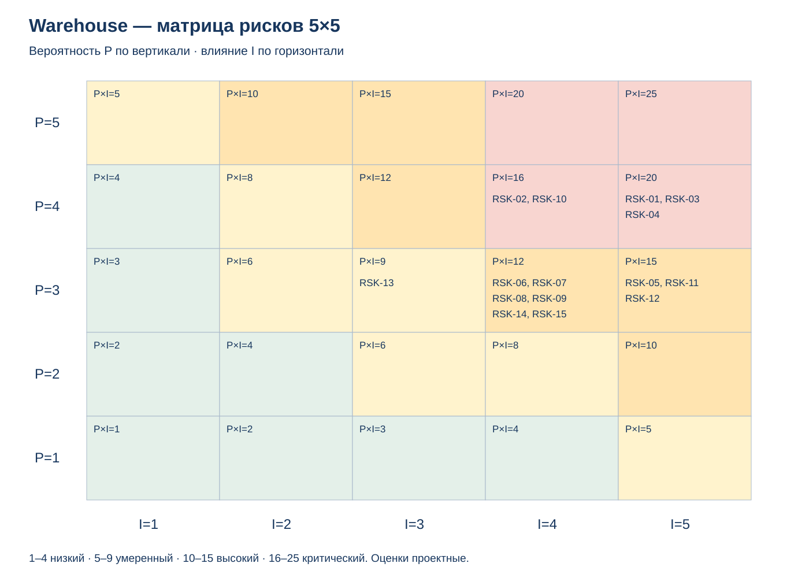

# Риски Warehouse и планы реагирования

| Поле | Значение |
| --- | --- |
| Идентификатор / версия | WH-RSK-001 / 1.3 |
| Дата | 12.11.2026 |
| Ответственная группа | Команда 3 — Warehouse |
| Статус | Проект для согласования |
| Источники | [DOC-01](../../../00_Documentation/DOC-01.md), [DOC-05](../../../00_Documentation/DOC-05.md), [DOC-07](../../../00_Documentation/DOC-07.md), [DOC-08](../../../00_Documentation/DOC-08.md), [DOC-09](../../../00_Documentation/DOC-09.md), [DOC-10](../../../00_Documentation/DOC-10.md); [INT-001/1.3](../../../06_integration_architecture/INT-001-target-model.md); [лекция 9](https://drive.google.com/file/d/1lJ031sMqHax1Wu-aFuFfX9qxt_g3PUJw/view) |
| Связанные требования | WH-R-03/09/10/11/12/16/18/21/22/23/24 — [каталог](../../01_Business_Architecture/Requirements/WH-REQ-001-requirements.md) |

## Метод и основания оценки

Используется шкала P/I 1–5 из главы 9: P — качественная вероятность, I — тяжесть последствий. Для P: 1 — редкое, 2 — маловероятное, 3 — возможное, 4 — вероятное, 5 — частое событие. Для I: 1 — локальное исправление, 2 — ограниченная задержка, 3 — заметные затраты/срыв части работ, 4 — существенное нарушение процесса/бюджета, 5 — остановка критичных операций, потеря подтверждённых данных или тяжёлый инцидент безопасности. Балл = P×I: 1–4 низкий, 5–9 умеренный, 10–15 высокий, 16–25 критический.

Оценки предложены командой на основании зависимости от WMS, противоречий As-Is и новых сценариев STORE; статистика частот отсутствует. Это новая качественная оценка, а не пересчёт старой шкалы 1–3 коэффициентом. Для RSK-01/04 высокая тяжесть связана с возможной потерей или двойным применением физического факта; для RSK-03 — с остановкой зависимой операции. У RSK-02 высокая вероятность обусловлена уже обнаруженными противоречиями источников.

Номера RSK-01–13 сохраняют исходный смысл реестра от 04.10.2026. Магазинный журнал включён в RSK-04, оплаченный резерв — в RSK-05. RSK-14/15 добавлены для частичного пополнения и массового переключения магазинов. Остаточные оценки ожидаются после мер и должны быть проверены на пилоте; сейчас все риски открыты.

## Реестр

| ID | Категория | Причина → последствие | P | I | Балл / приоритет | Владелец |
| --- | --- | --- | ---: | ---: | --- | --- |
| RSK-01 | Архитектура/технологии | WMS не поддержит атомарный reserve, удержание оплаченного резерва или полный журнал → Нельзя доказать отсутствие потерь/двойных операций | 4 | 5 | 20 / Критический | Архитектор WMS |
| RSK-02 | Исходные данные/архитектура | Противоречия источников о масштабе сети и текущих каналах не закрыты → Неверный объём решения, смета и нагрузочные требования | 4 | 4 | 16 / Критический | Архитектор и логистика |
| RSK-03 | Технологии/организация | Отказ WMS/БД или канала центрального склада/магазина → Остановка операций, отставание магазина и нарушение SLA | 4 | 5 | 20 / Критический | Эксплуатация WMS и ответственный магазина |
| RSK-04 | Данные/интеграции | Потеря или повтор события CENTRAL/STORE и разрыв магазинного журнала → Двойной расход либо исчезновение физического факта | 4 | 5 | 20 / Критический | Владелец интеграции Warehouse |
| RSK-05 | Архитектура/данные | Гонка оплаты, expiry и позднего задания ERP → Оплачен необеспеченный заказ или освобождён отобранный товар | 3 | 5 | 15 / Высокий | Владельцы заказа и WMS |
| RSK-06 | Финансы | STORE-объём/лицензии или доля платформы дороже допущений → Превышена доля бюджета или общий лимит | 3 | 4 | 12 / Высокий | Финансовый координатор |
| RSK-07 | Организация | Сотрудники обходят новые действия → Факты не попадают в журнал, данные расходятся | 3 | 4 | 12 / Высокий | Начальник склада / руководитель магазина |
| RSK-08 | Архитектура/организация | Соседи не приняли версии контрактов → Несовместимые состояния заказа/запаса | 3 | 4 | 12 / Высокий | Координатор Warehouse |
| RSK-09 | Организация/технологии | Нет компетенций общей контейнерной эксплуатации → Срывы восстановления и рост поддержки | 3 | 4 | 12 / Высокий | ИТ-директор |
| RSK-10 | Финансы | Высвобождённое время не становится денежной экономией → NPV/IRR ниже требуемого уровня | 4 | 4 | 16 / Критический | Логистика и финансы |
| RSK-11 | Безопасность | Магазин передал чужой locationId или неразрешённую корректировку → Несанкционированное изменение запасов/утечка | 3 | 5 | 15 / Высокий | Владелец безопасности ИТ |
| RSK-12 | Данные/миграция | Откат восстановил старую БД поверх новых операций → Потеря подтверждённых движений и ключей повторов | 3 | 5 | 15 / Высокий | Руководитель миграции |
| RSK-13 | Данные/ИИ | Прогноз нагрузки ошибается в сезонный пик → Ошибочное планирование смены | 3 | 3 | 9 / Умеренный | Логистика и аналитика |
| RSK-14 | Данные/миграция | Пополнение или частичная приёмка сопоставлены неверно → Двойной STORE-приход и неверный товар в пути | 3 | 4 | 12 / Высокий | Логистика и закупки |
| RSK-15 | Проект/организация | Одновременное переключение всех магазинов скрывает дефекты пилота → Массовые расхождения и срыв запуска | 3 | 4 | 12 / Высокий | Руководитель проекта |

## Матрица 5×5

| P \ I | 1 | 2 | 3 | 4 | 5 |
| --- | --- | --- | --- | --- | --- |
| 5 | — | — | — | — | — |
| 4 | — | — | — | RSK-02, RSK-10 | RSK-01, RSK-03, RSK-04 |
| 3 | — | — | RSK-13 | RSK-06, RSK-07, RSK-08, RSK-09, RSK-14, RSK-15 | RSK-05, RSK-11, RSK-12 |
| 2 | — | — | — | — | — |
| 1 | — | — | — | — | — |

## Меры, триггеры и остаточная оценка

| ID | Стратегия | Предупреждающие меры | Триггер | Действия при наступлении | Остаточная P×I |
| --- | --- | --- | --- | --- | ---: |
| RSK-01 | Снизить | Проверка поставщика и прототип до расширения пилота | Нет поддерживаемого API/outbox либо отрицательный контрактный сценарий | Остановить спорный маршрут; пересмотреть ADR, не создавать второго мастера | 2×5=10 |
| RSK-02 | Снизить | Инвентаризация каналов/площадок, проверка DOC-05/16/17 и вопросов WH-Q-01–08 до оценки | Новый подтверждённый факт меняет масштаб, интерфейс или состав пользователей | Остановить спорное решение, уточнить источник, пересчитать архитектуру/ТЭО/план до пилота | 2×4=8 |
| RSK-03 | Снизить | Резервирование зависимостей, копии/журналы, устойчивый буфер и учения восстановления | Недоступна обязательная операция, истёк heartbeat timeout либо исчерпывается локальный буфер | Ограничить затронутые операции, восстановить связь/систему, догрузить журнал и сверить физические факты | 2×5=10 |
| RSK-04 | Снизить | Бизнес-уникальность, атомарный фиксация транзакции, исходные ID и резервная копия курсоров | Пропуск границы, конфликт movementId или расхождение контрольного снимка | Ограничить запись затронутой локации, догрузить журнал, сверить факт | 2×5=10 |
| RSK-05 | Снизить | Версии, устойчивый запрет ERP, проверки задачи перед освобождением резерва | UNKNOWN confirm-paid, просроченный holdDeadline или поздняя создание задания после отмены | Сверить прежний результат; отмена/возврат физического товара/возврат денег по подтверждениям | 2×5=10 |
| RSK-06 | Снизить | Смета на одинаковый границы проекта, единое распределение общей платформы | Новая смета выходит за согласованную доменную долю | Пересчитать A/B, отложить необязательную оптимизацию, сохранить обязательные инварианты | 2×4=8 |
| RSK-07 | Снизить | Пилот смены, обучение до запуска, удобство ТСД | Физический документ без movementId или повторные обходные записи | Ограничить расширение, исправить процесс/интерфейс и повторить обучение | 2×3=6 |
| RSK-08 | Избежать | Реестр IF, совместимые схемы и контрактный стенд | Нет подтверждения стороны или провален пример контракта | Не переключать спорную операцию до разрешения разногласий | 1×4=4 |
| RSK-09 | Снизить | Общая команда поддержки, инструкции и учения | Не назначены дежурные или не выполнено учение переключение на резерв | Переходный вариант A на VM с доказанными свойствами | 2×3=6 |
| RSK-10 | Снизить | Базовый замер по типам операций и исключение двойных выгод | Нет подтверждённых сверхурочных/услуг/предотвращённого найма для эффекта | Убрать немонетизируемую часть, пересчитать ТЭО и масштаб | 3×3=9 |
| RSK-11 | Снизить | Раздельные сервисные учётные записи, области доступа, MFA критичных операций, аудит | Нарушен область доступа/право, обнаружен секрет в логе | Отозвать доступ, локализовать, сохранить доказательства и сверить данные | 2×4=8 |
| RSK-12 | Снизить | Совместимые версии, журнал операций и репетиция возврата | Несовместимая схема или неучтённый хвост после подтверждённая граница | Остановить новые команды, сохранить хвост, восстановить и сверить до повторная доставка | 2×5=10 |
| RSK-13 | Принять ограниченно | Пилот без зависимости операций, человек принимает решение | Ошибка выше заранее принятого порога или деградация сезонного базовый уровень | Отключить модель, обычное планирование; не менять Stock по прогнозу | 2×2=4 |
| RSK-14 | Снизить | Уникальные receiptId/movementId, mapping площадок и тест 8+2 | received больше dispatched или нет связанного transferId | Карантин расхождения; физическая сверка отправителя и получателя | 2×4=8 |
| RSK-15 | Избежать | Волны с критериями готовности и возвратом маршрута | Пилот не покрывает offline/пик/частичная приёмка перемещения | Остановить следующую волну; стабилизировать текущую до расширения | 1×4=4 |

## Приоритетные планы ответа

**RSK-01 — возможности WMS.** До M2 архитектор и владелец WMS проверяют поддерживаемые reserve/confirm-paid/expiry, фиксацию движения и журнала в одной транзакции, восстановление результата. Отрицательный контрактный пример или отсутствие поддерживаемого механизма — триггер остановки соответствующего маршрута. Архитектор собирает владельцев ERP/канала/платформы, пересматривает ADR и оценку. Допуск к пилоту — только после согласованного механизма и успешных проверок. Остаточная оценка 2×5=10: зависимость от установленной WMS сохраняет высокую тяжесть последствий.

**RSK-04 — потеря или повтор движения.** До M4 интеграционная команда проверяет потерянный ответ, повтор, N+1 раньше N, смену journalId и восстановление по снимку с подтверждённой границей. При пропуске границы либо расхождении уникальных движений дежурный ограничивает затронутую локацию/SKU, сохраняет журнал и выполняет догрузку с прежними ID. Логистика и эксплуатация сверяют физические факты; повторная отправка с новыми ID не используется. Снятие ограничений — после подтверждённой сверки. Остаточная оценка 2×5=10 отражает тяжесть восстановления учёта даже при уменьшении вероятности.

**RSK-03 — отказ системы или связи.** До M4 эксплуатация проверяет переключение WMS/БД, восстановление копий и журналов, резервный канал и ёмкость магазина на согласованное автономное окно. Триггер — недоступная обязательная операция, отсутствие heartbeat либо приближение к безопасному пределу буфера. Ответственный магазина ограничивает новые операции по регламенту; WMS помечает STORE как OFFLINE, закупки приостанавливают автоматическое пополнение. После восстановления выполняются доставка, бизнес-подтверждение и сверка. Продолжение разрешают логистика и эксплуатация. Остаточная оценка 2×5=10 сохраняет тяжесть зависимости физического процесса от ИТ и связи.

## Связь с планом и условия перехода

M1–M2 проверяют RSK-01/02/06/08/10; M3 — RSK-03/09/11; M4 — RSK-04/12/14; M5–M7 — RSK-05/07/15. Необязательный прогноз связан с RSK-13 и не включён в базовый эффект ТЭО.

Не включать новый маршрут при недоказанной однократности движений/резерва; не расширять пилот без сверки и восстановления; не переключать спорный контракт без владельца и версии. Бюджет и эксплуатационная ответственность подтверждаются до закупок. Порог буфера, heartbeat timeout и профиль нагрузки согласуются до пилота.

[Дорожная карта](../Roadmap/WH-ROAD-001-roadmap.md), [приёмочные сценарии](../../04_Technology_Architecture/Monitoring/WH-OPS-001-operations.md), [ТЭО](../TCO_ROI/WH-ECO-001-business-case.md).

[К содержанию Warehouse](../../README.md)
