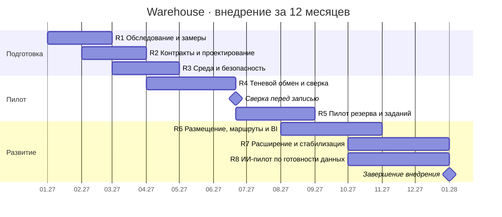

# Warehouse — ТЭО, риски и дорожная карта

Расчёт для центрального склада RetailMax по [DOC-10](../00_Documentation/DOC-10.md). Горизонт — пять лет эксплуатации. Суммы указаны в денежных единицах учебного кейса. Доля текущих затрат, смета и годовой эффект — проектные допущения. В [расчётной книге Warehouse](07_Project_Management/TCO_ROI/Warehouse_Economics.xlsx) есть формулы по обоим вариантам. Вкладка готова к импорту в общую Google Таблицу проекта.

## Исходные данные

| Параметр | Значение | Основание |
| --- | ---: | --- |
| Общий бюджет проекта | 850 000 | DOC-10 |
| Текущие годовые ИТ-затраты компании | 720 000 | DOC-10 |
| Доля Warehouse в текущих ИТ-затратах | 20% | Учебное допущение |
| Вложения Warehouse в момент t0 | 140 000 | [Смета, включая резерв 20 000](07_Project_Management/TCO_ROI/WH-ECO-001-business-case.md#единовременные-вложения) |
| Дополнительный OPEX в год | 18 000 | Ресурсы, поддержка, восстановление и обучение |
| Реализуемый эффект в год со второго года | 75 000 | 55 000 экономии оплачиваемой трудоёмкости и 20 000 предотвращённых затрат на ошибки |
| Ставка дисконтирования | 10% | Учебное допущение |

Базовый вариант сохраняет ERP и WMS, добавляет складской адаптер на общей платформе и использует одну транзакционную границу WMS для изменения запаса. Условия выбора и варианты размещения описаны в [ADR по источнику остатка](05_Architecture_Decisions/ADR/ADR-WH-001-inventory-authority.md) и [ADR по развёртыванию](05_Architecture_Decisions/ADR/ADR-WH-003-deployment.md).

## Расчёт и итоговые показатели

| Показатель | Формула | Результат |
| --- | --- | ---: |
| Вложения как доля общего бюджета | 140 000 / 850 000 | 16,47% |
| Годовой OPEX As-Is → To-Be | 720 000 × 20% → 144 000 + 18 000 | 144 000 → 162 000 |
| TCO As-Is за 5 лет | 144 000 × 5 | 720 000 |
| TCO To-Be за 5 лет до эффектов | 140 000 + 162 000 × 5 | 950 000 |
| Валовой эффект | 75 000 × 4 | 300 000 |
| Дополнительные затраты | 140 000 + 18 000 × 5 | 230 000 |
| Чистый эффект | 300 000 − 230 000 | 70 000 |
| ROI | 70 000 / 230 000 | 30,43% |
| NPV на t0 | Сумма потоков t0–5, дисконтированных по 10% | 7 893 |
| IRR | Ставка, при которой NPV чистого потока равна нулю | 11,67% |
| PI | Приведённые чистые потоки за годы 1–5 / CAPEX | 1,056 |
| Простая окупаемость | 3 + 44 000 / 57 000 при равномерном эффекте в 4-м году | 3,77 года эксплуатации |

| Период | t0 | Год 1 | Год 2 | Год 3 | Год 4 | Год 5 |
| --- | ---: | ---: | ---: | ---: | ---: | ---: |
| Чистый дополнительный поток | −140 000 | −18 000 | 57 000 | 57 000 | 57 000 | 57 000 |
| Накопленный поток | −140 000 | −158 000 | −101 000 | −44 000 | 13 000 | 70 000 |

При эффекте **45 000** в год ROI составляет **−21,74%**, NPV — **−78 558**, окупаемости в пределах горизонта нет. При эффекте **100 000** ROI составляет **73,91%**, NPV — **79 935**. Для положительного NPV годовой эффект со второго года должен превысить примерно **72 261**. Перед утверждением финансовая команда проверяет экономию по оплаченным часам и стоимости ошибок, а также долю расходов на общую платформу. [Детальное ТЭО](07_Project_Management/TCO_ROI/WH-ECO-001-business-case.md)

## Архитектурные альтернативы

| Вариант | CAPEX | OPEX в год | TCO за 5 лет | NPV при 10% | IRR | PI | Окупаемость |
| --- | ---: | ---: | ---: | ---: | ---: | ---: | ---: |
| A · Адаптер на VM | 130 000 | 170 000 | 980 000 | −12 433 | 7,17% | 0,904 | 4,18 года |
| B · Адаптер в общем Kubernetes | 140 000 | 162 000 | 950 000 | 7 893 | 11,67% | 1,056 | 3,77 года |

В базовом сценарии выбираем вариант B при подтверждённых ресурсах и стоимости общей платформы. Вариант A остаётся переходным при согласовании сметы. [Допущения, денежные потоки и чувствительность двух вариантов](07_Project_Management/TCO_ROI/WH-ECO-001-business-case.md#сравнение-вариантов-развёртывания)

## Ключевые риски

Вероятность и влияние оценены от 1 до 3. Баллы 6–9 означают высокий риск.

| Риск | Балл | Ответственный | Условие перехода |
| --- | ---: | --- | --- |
| RSK-02. Противоречивые сведения о текущем обмене ERP–WMS | 9 | Архитектор | Проверить фактические каналы, объёмы, владельцев и базовые метрики до проектирования |
| RSK-01. Поставщик WMS не подтверждает транзакционный резерв или журнал | 6 | Владелец WMS | Подтвердить возможности WMS и пройти гонку за последнюю единицу до пилота |
| RSK-04. Потеря или дублирование события ведёт к расхождениям | 6 | Команда интеграции | Проверить восстановление отправки после сбоя и повторную доставку без второго списания |
| RSK-08. Смежные команды не согласовали контракты | 6 | Координатор Warehouse | Зафиксировать версии API, владельцев и сценарии компенсации до переключения трафика |
| RSK-03/12. Простой или потеря складских фактов при отказе и откате | 6 каждый | Эксплуатация, начальник склада | Проверить восстановление и сверку новых физических операций на пилоте |
| RSK-06/10. Рост затрат или недостижение денежного эффекта | 6 каждый | Финансы, логистика | Подтвердить смету и измеримый денежный эффект перед масштабированием |

[Матрица вероятности и влияния](07_Project_Management/Risks/WH-RSK-001-risks.md#матрица-вероятности-и-влияния) · [Полный реестр рисков и резервные планы](07_Project_Management/Risks/WH-RSK-001-risks.md)

## Дорожная карта внедрения

Условное начало — 1 января 2027 года, горизонт внедрения — 12 месяцев. Календарь показывает месяцы М1–М12 из [плана внедрения](07_Project_Management/Roadmap/WH-ROAD-001-roadmap.md). Подготовительные работы могут перекрываться. Переключение записи начинается после сверки теневого контура, а расширение — после приёмки пилота.

