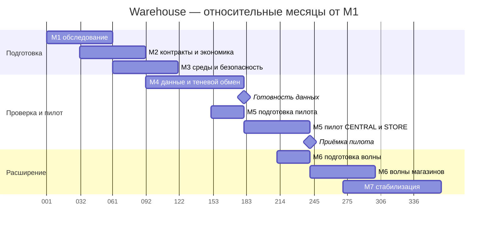

# Warehouse — экономика, риски и дорожная карта

Версия 1.3, 12.11.2026. Охват CENTRAL+STORE; проект для согласования. Все доменные суммы — учебные допущения в условной валюте DOC-10.

| Показатель | A — обязательное расширение | B — автоматизация и общий контур |
| --- | ---: | ---: |
| Первоначальные вложения | 160 000 | 220 000 |
| Дополнительный OPEX в год | 24 000 | 30 000 |
| Годовой эффект со 2-го года | 90 000 | 125 000 |
| TCO за 5 лет до вычета выгод | 1 180 000 | 1 270 000 |
| ROI на дополнительные затраты | 28,57% | 35,14% |
| NPV при ставке 10% | 8 374 | 26 488 |
| IRR | 11,53% | 13,50% |
| PI по чистым потокам | 1,046 | 1,107 |
| Простая окупаемость | 3,79 года | 3,63 года |

Условно выбран B при подтверждённом эффекте и общей инфраструктуре; A сохраняет обязательные функции. Денежная экономия времени требует подтверждения, NPV чувствителен к задержке и эффекту. Формулы, состав затрат, альтернативы и чувствительность — [ТЭО](07_Project_Management/TCO_ROI/WH-ECO-001-business-case.md), [Excel](07_Project_Management/TCO_ROI/Warehouse_Economics.xlsx). Для переноса на вкладку команды общей Google-таблицы; внешняя таблица не редактировалась, её URL в предоставленных материалах не указан.

## Приоритетные риски

| Риск | Последствие | Меры и владелец |
| --- | --- | --- |
| RSK-01: WMS не поддерживает необходимую транзакцию/журнал | Нельзя доказать однократное применение и удержание резерва | Проверка поставщика и контрактных примеров до пилота; архитектор и владелец WMS |
| RSK-04: потеря/повтор движения, разрыв STORE-журнала | Расхождение физического и подтверждённого запаса | Устойчивый журнал, прежние ID, непрерывная граница, сверка; владелец интеграции Warehouse |
| RSK-03: отказ WMS/БД или связи | Остановка операции и отставание магазина | Резервирование, восстановление и безопасный автономный режим; эксплуатация и ответственный магазина |

Оценки рисков и меры являются проектными. Реестр из 15 рисков, матрица 5×5 и подробные планы ответа — в [WH-RSK-001](07_Project_Management/Risks/WH-RSK-001-risks.md). Денежный эффект проверяется по RSK-10 до инвестиционного решения. Контрольные точки и владельцы этапов — в [дорожной карте](07_Project_Management/Roadmap/WH-ROAD-001-roadmap.md).

## Дорожная карта Mermaid Gantt

График использует условную ось: **2000-01-01 = начало относительного месяца 1**, каждый месяц на схеме условно 30 дней. Это техническая привязка для Mermaid, не календарная дата проекта. Таблица roadmap с месяцами 1–12 — основное описание сроков и зависимостей.

Окна частично перекрываются только для подготовки: фактическое включение операций M5/M6 разрешается после контрольной приёмки предшествующего результата. Для отдельных волн сохраняется один писатель и собственная граница переключения. При провале проверки переход останавливается.
