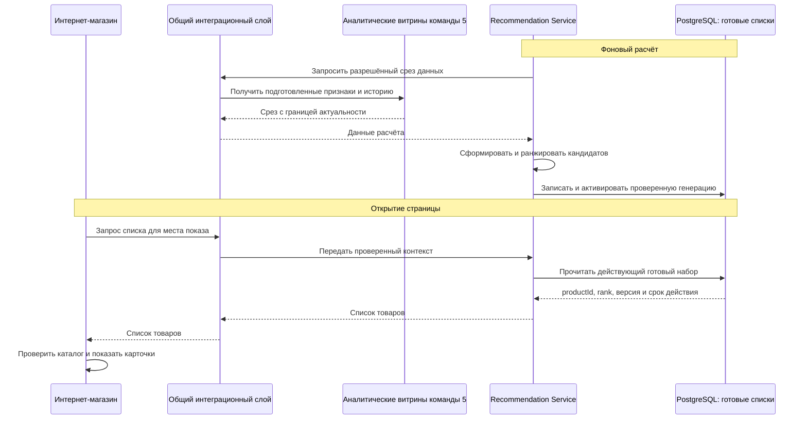

# ADR-EC-005. Создание, хранение и выдача товарных рекомендаций

| Поле | Значение |
|---|---|
| Версия / дата | 1.1 / 22.10.2026 |
| Статус | Предложено |
| Проблема | EC-P-08 — не определён полный процесс товарных рекомендаций |
| Требования | REQ-EC-010; REQ-EC-004/005/009; AI-01 из DOC-12 |
| Участники согласования | E-commerce, команда 5 / персонализация и аналитика, маркетинг, каталог, безопасность и общий слой |

## Контекст

Покупатели ожидают персональных рекомендаций, но в архитектуре интернет-продаж не определена полная цепочка: из каких данных рассчитываются рекомендации, кто их создаёт, где сохраняет и как сайт получает результат. Одного упоминания AI-сервиса недостаточно для проектирования этой возможности.

Рекомендация — упорядоченный список productId для покупателя или контекста показа. Она не является мастер-записью товара, ценой, остатком или резервом. CRM остаётся источником профиля/customerId, ERP — товара и базовой цены, WMS — центрального остатка. Customer Data Hub и общий MDM не создаются. Все межсервисные обмены проходят через общий интеграционный слой.

## Рассматриваемые варианты

| Вариант | Преимущества | Недостатки / причина отказа |
|---|---|---|
| Формировать рекомендации внутри сайта при каждом открытии страницы | Простое подключение первых правил | Расчёт увеличивает время ответа сайта, связан с его релизами и нагрузкой |
| Вызывать тяжёлую ML-модель в каждом пользовательском запросе | Можно учитывать весь текущий контекст | Зависимость страницы от вычислений и аналитики, более сложная эксплуатация |
| Рассчитывать списки фоном, хранить готовые результаты, выдавать через отдельный API | Быстрая выдача, независимое обновление алгоритма, контролируемое восстановление | Нужны хранение результатов и правила актуальности; **выбран** |

## Выбранное решение

Использовать один логический **Recommendation Service**, развиваемый совместно с командой 5 и повторно используемый онлайн-каналом. Команда 5 отвечает за алгоритм, вычисления и хранилище результатов; e-commerce — за места показа, контекст запроса, фильтрацию карточек и события взаимодействия. Отдельная рекомендательная платформа e-commerce не создаётся.

### 1. Как создаются рекомендации

| Данные | Источник и назначение |
|---|---|
| Каталог, категории, активность товара | ERP / каталог через общий слой: какие товары можно рекомендовать и как они связаны |
| История покупок, отмен и возвратов | Подтверждённые факты онлайн-заказов и учётных систем; возврат не считается новой покупкой, одно событие не учитывается дважды |
| Просмотры, клики, добавления в корзину | Интернет-магазин через общий слой, при разрешённом использовании поведенческих данных |
| Идентификатор покупателя | Подтверждённый customerId CRM; контактные данные для расчёта списка не нужны |
| Контекст показа | Место на сайте, просматриваемый товар/категория, разрешённый контекст текущей сессии |

Потребители команды 5 сохраняют разрешённую историю и подготовленные признаки в её аналитических витринах. Фоновая задача Recommendation Service читает эти витрины и каталог, рассчитывает кандидатов и ранжирует их. Пользовательский запрос сайта не запускает обучение или массовый пересчёт.

Начальная версия использует объяснимые правила: популярные товары категории, сопутствующие товары и предпочтения категорий по разрешённой истории покупок/просмотров. Для нового или неизвестного покупателя формируется контекстный список без персонального профиля. ML-модель подключается в том же контракте после сравнения с этими правилами; конкретный алгоритм заранее не предписывается.

**Начальный проектный режим — фоновый пересчёт раз в час.** Это настройка предложения, а не значение из исходного кейса; период и стоимость уточняются на нагрузочной проверке. Изменения доступности/активности товара применяются также при показе, поэтому часовой пересчёт не является гарантией наличия.

### 2. Где хранятся данные и результаты

| Что | Где хранится | Кто пишет / читает |
|---|---|---|
| История событий и подготовленные признаки | Существующий/проектируемый аналитический контур команды 5; его физическое размещение определяется её архитектурой | Источники публикуют через общий слой; расчёт использует подготовленные данные |
| Готовые персональные и контекстные списки | **PostgreSQL, отдельная логическая схема рекомендаций**; используется поддерживаемая инфраструктура, без нового кластера по умолчанию | Только Recommendation Service/его фоновый расчёт пишет; выдача читает результаты |
| Популярные товары для резервного показа | Та же схема PostgreSQL как неперсональные наборы; последняя разрешённая копия может храниться в кэше витрины | Фоновый расчёт публикует, витрина читает через API и сохраняет копию для сбоя |
| Версия правил или модели | Версионируемый артефакт выпуска компонента команды 5 | Расчёт использует фиксированную версию; результат хранит ссылку на неё |

Схема результатов принадлежит рекомендательной возможности, а не профилю CRM. Она не хранит золотую запись клиента, бонусный баланс, контакты или независимый остаток. PostgreSQL выбран как поддерживаемая в кейсе СУБД для чтения небольших готовых списков по ключу. Отдельные Redis, векторная БД или feature store этим ADR не вводятся.

| Логическая сущность | Основные поля |
|---|---|
| RecommendationGeneration | generationId, ruleOrModelVersion, sourceAsOf, generatedAt, validUntil, status: BUILDING/READY/ACTIVE/FAILED |
| RecommendationSet | setId, generationId, audienceType: CUSTOMER/CONTEXT/POPULAR, customerId либо contextKey, placement |
| RecommendationItem | setId, productId, rank, score/reasonCode при наличии |

Ключ запроса включает место показа и тип аудитории: личный список customerId не смешивается со списком похожих товаров или общей популярностью. Индексы обеспечивают поиск набора по этому ключу и чтение строк по rank.

Расчёт сначала записывает новую генерацию полностью и проверяет ссылки на товары, повторы и состав наборов. Затем в одной транзакции переключает указатель активной генерации для согласованной области выдачи. Незавершённый расчёт не становится виден пользователю и не смешивается со старым результатом. Ошибка оставляет предыдущую ещё действующую генерацию.

Для каждого набора задан validUntil; API не отдаёт просроченный набор как актуальный. Начальная проектная политика — срок действия два часа при ежечасном пересчёте, с дальнейшей настройкой по данным пилота. Предыдущая генерация может использоваться для отката только пока она действительна и разрешена. Сроки удаления старых результатов и персональной истории определяются отдельно владельцами данных; время жизни выдачи не равно сроку хранения персональных данных.

### 3. Как рекомендации попадают на сайт

1. Витрина обращается через общий слой к Recommendation Service с placement, контекстом товара/категории и ограничением числа позиций. Для авторизованного покупателя сервер добавляет подтверждённый customerId из проверенной сессии; браузер не выбирает произвольный чужой ID.
2. Сервис находит действующий персональный набор, затем при его отсутствии — контекстный или общий популярный. Из PostgreSQL читается готовый результат, модель в запросе не обучается.
3. Ответ содержит recommendationSetId, generationId, ruleOrModelVersion, generatedAt, validUntil и упорядоченные productId с rank. Цена и обещание наличия в ответ не включаются.
4. Каталог сайта дополняет позиции актуальными данными карточек и своей проекцией доступности, исключает снятые с публикации/недопустимые товары и дубли. Для корзины исключаются уже добавленные позиции по правилу размещения.
5. Если позиций мало, сайт запрашивает/использует разрешённый резервный список и применяет ту же фильтрацию. Пустой блок допустим. Только оформление заказа подтверждает резерв WMS по ADR-EC-002.
6. После фактического показа и действий пользователя сайт публикует события impression/click/add-to-cart через общий слой с eventId, recommendationSetId, generationId, placement и productId. Запрос API без отображения не считается показом.

API выдачи возвращает только разрешённый набор. Его точный endpoint и размер списка фиксируются в общем каталоге API при реализации; описанный выше запрос/ответ — проект контракта.

### 4. Как работает отказ и обновление

Выдача ограничена таймаутом в рамках бюджета ответа витрины. При медленном/недоступном сервисе используется действующая неперсональная копия популярных товаров в кэше витрины либо блок скрывается. Чужой персональный набор не используется как резервный. Копия проверяется по validUntil и текущему каталогу.

Недоступность аналитики останавливает новый расчёт, но не чтение ещё действующих результатов из PostgreSQL. Ошибка фонового расчёта не переключает активную генерацию. После истечения всех разрешённых наборов блок скрывается; основной каталог, корзина, оплата и исполнение заказа продолжают работать. Повторные запросы/события обрабатываются по ADR-EC-001.

### 5. Проверка пользы и защита данных

Контролировать успешность и длительность расчёта, возраст активной генерации, ошибки публикации, задержку API, долю резервного/пустого показа и доступность PostgreSQL. Для качества измерять покрытие каталога, показы/клики и добавления в корзину, а бизнес-эффект проверять контролируемым пилотом с популярными товарами как базовым вариантом. Рост продаж не заявляется до измерения.

Персональные результаты доступны только по правам сервисов и принадлежности сессии. Права записи в схему выдачи есть только у расчёта/Recommendation Service. customerId не делает данные автоматически обезличенными: сроки хранения, удаление, разрешённость обучения и персонализации согласуются с владельцами данных. Запрос на исключение клиента из персонализации запрещает его персональную выдачу и инвалидирует соответствующие наборы; служебный откат не должен возвращать запрещённый набор.

## Обоснование

Предрасчёт отделяет создание рекомендаций от пользовательского запроса. Хранение готовых списков в PostgreSQL даёт явную точку записи, версии и управляемую публикацию; витрина может быстро читать результат и безопасно переходить к популярным товарам. Один сервис команды 5 переиспользует её аналитику и не создаёт второй профиль клиента или общий MDM.

## Связанные требования

| Требование | Как поддерживается |
|---|---|
| REQ-EC-010 | Определены создание, хранение, версия, API выдачи, контекстный резерв и обратная связь |
| REQ-EC-004/005 | Фоновый расчёт и готовые списки изолируют нагрузку; отказ рекомендаций не блокирует магазин |
| REQ-EC-009 | Права на персональные наборы, проверенный customerId, минимальный состав данных и инвалидирование |
| AI-01 из DOC-12 | Версия алгоритма, контроль качества и пилот против простых правил |

## Последствия и риски

Появляется понятная цепочка от исходных данных до блока товаров на сайте. Нужны фоновый расчёт, схема PostgreSQL, контроль генераций и контракт с командой 5. Персонализация обновляется периодически и может отставать от последнего действия пользователя; свежие ограничения каталога применяются при показе. Сервис рекомендаций не меняет цену, остаток, резерв или финансовый результат заказа.

Общая задача оперативной отчётности EC-P-07 остаётся в ответственности аналитики команды 5. ADR-EC-001 описывает доставку её исходных данных; данный ADR фокусируется на рекомендациях и не объявляет решённым SLA корпоративных отчётов.

## Проверка и условия пересмотра

| Проверка | Ожидаемый результат |
|---|---|
| Расчёт для известного и нового покупателя | Получены персональный и разрешённый контекстный/популярный наборы, без требования создавать профиль для анонимного просмотра |
| Сбой при записи новой генерации | Активна прежняя действующая генерация; частичный результат не виден |
| Публикация и откат версии | В ответе один согласованный набор/версия; просроченные или запрещённые результаты не возвращаются |
| Товар снят с продажи / нет доступности | Карточка отфильтрована перед показом; рекомендация не выдаётся за резерв |
| Аналитика, API или PostgreSQL недоступны | Действующая резервная копия либо скрытый блок; оформление заказа работает |
| Два клиента / подмена customerId | Нет доступа к чужому персональному списку |
| Повтор клика / API без показа | Дубликат не увеличивает метрику; запрос API не считается impression |
| Отказ от персонализации | Персональный набор исключён из выдачи и отката, разрешён только неперсональный контекст |

До реализации согласовать владельца сервиса/схемы с командой 5, места показа, разрешённые источники, SLO выдачи, период пересчёта и сроки хранения. Если предрасчёт не даёт полезного качества или не укладывается в ресурсы, пересматриваются правила/частота и только затем необходимость online-inference или дополнительных хранилищ.

## Основания и зависимости

[EC-P-08](../../01_Business_Architecture/Requirements/EC-PRB-001-problems.md), [REQ-EC-010](../../01_Business_Architecture/Requirements/requirements.md), [DOC-07](../../../00_Documentation/DOC-07.md), [DOC-08](../../../00_Documentation/DOC-08.md), [DOC-11](../../../00_Documentation/DOC-11.md), [DOC-12](../../../00_Documentation/DOC-12.md), [DOC-17](../../../00_Documentation/DOC-17.md). Зависит от ADR-EC-001/002/003/004. [К реестру ADR](../README.md).
