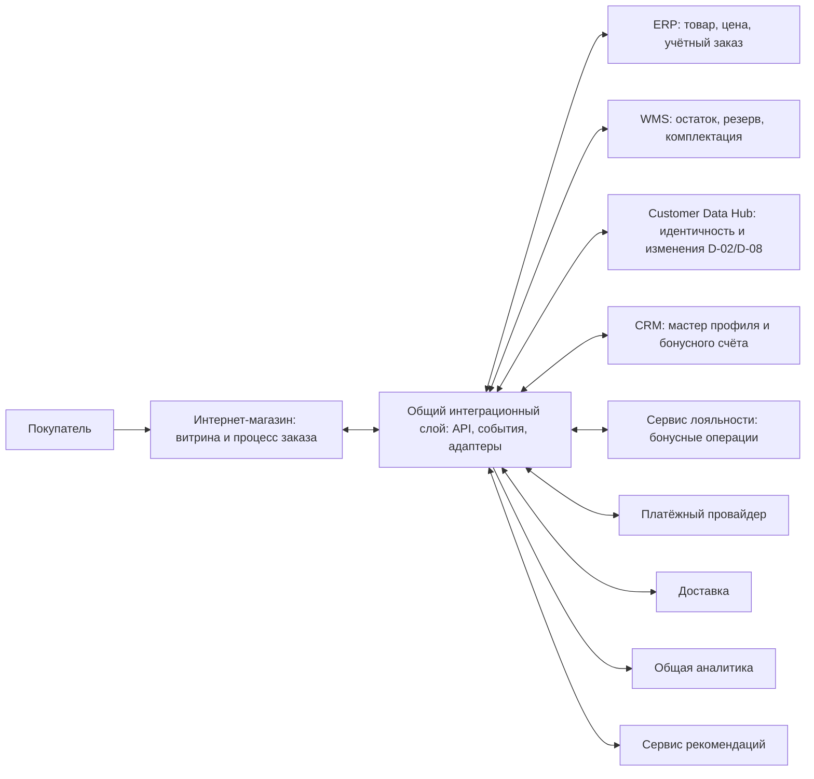

# Архитектурные решения интернет-продаж — To-Be

| Поле | Значение |
|---|---|
| Идентификатор / версия | EC-ADR-INDEX / 1.2 |
| Дата | 22.10.2026 |
| Ответственная группа | Команда 4 — интернет-продажи |
| Статус | Предложено; пакет для согласования |
| Основание | [Проблемы EC-P-01–08](../01_Business_Architecture/Requirements/EC-PRB-001-problems.md), [REQ-EC-001–010](../01_Business_Architecture/Requirements/requirements.md), [архитектура As-Is](../02_Application_Architecture/APP-EC-001-as-is.md), [BP-04 As-Is](../06_Architecture_Models/BPMN/BP-04-internet-sales-as-is.md) |

## Что зафиксировано

**Общая исходная договорённость:** все команды совместно проектируют единый интеграционный слой между доменными сервисами, ERP, WMS, CRM и другими участниками обмена. Это указание команды от 22.10.2026, а не вывод о текущем состоянии систем. ADR-EC-001 определяет участие интернет-продаж в этом слое. Конкретные продукты, топология и эксплуатационный владелец платформы ещё требуют межкомандного решения.

Пять действующих ADR имеют статус «Предложено»: выбранные в них варианты являются рекомендацией команды для To-Be. ADR-EC-003 и ADR-EC-004 заменены ADR-EC-001; их номера сохраняются для истории. Ни внедрение, ни согласование владельцами внешних систем здесь не утверждаются. Структура следует [шаблону DOC-14](../../00_Documentation/DOC-14.md), раздел 9: контекст, варианты, выбор, последствия; добавлены зависимости и проверки решения.

## Реестр ADR и покрытие проблем

| ADR | Предлагаемое решение | Проблемы | Требования |
|---|---|---|---|
| [ADR-EC-001](ADR/ADR-EC-001-shared-integration.md) | Общий интеграционный слой: API, события, координация обменов и надёжная доставка | EC-P-02, EC-P-04, EC-P-06 | REQ-EC-002/003/006/007/008/009 |
| [ADR-EC-002](ADR/ADR-EC-002-availability-reservation.md) | Проекция доступности для просмотра и атомарный резерв WMS до оплаты | EC-P-01, EC-P-02 | REQ-EC-001/002/003/006/007 |
| [ADR-EC-005](ADR/ADR-EC-005-service-boundaries-delivery.md) | Поэтапное выделение сервисов, масштабирование и безопасные релизы | EC-P-03, EC-P-08 | REQ-EC-004/005/008 |
| [ADR-EC-006](ADR/ADR-EC-006-customer-identity.md) | Единый customerId и обязательный Customer Data Hub перед CRM | EC-P-05 | REQ-EC-009; AA-RET-02/04, DA-RET-01/04; DOC-12/17 |
| [ADR-EC-007](ADR/ADR-EC-007-analytics-recommendations.md) | События для аналитики и необязательный сервис рекомендаций | EC-P-07, EC-P-08 | REQ-EC-010; DA-03/AI-01 из DOC-12 |

Заменённые записи: [ADR-EC-003](ADR/ADR-EC-003-order-lifecycle.md) и [ADR-EC-004](ADR/ADR-EC-004-reliable-exchange.md) ведут к ADR-EC-001. Бизнес-правила заказа, оплаты, отмен и возвратов будут описаны отдельно в процессе и контрактах; самостоятельный ADR для них сейчас не создаётся.

REQ-EC-009 задаёт безопасность, а не уникальность профиля. Для EC-P-05 основание дополнено требованиями управления данными DOC-06/12/17. REQ-EC-010 задаёт рекомендации, но не отдельный SLA аналитики: последний берётся из DOC-08 и согласуется с командой 5.

## Границы владения

| Область | Источник и ответственность | Роль интернет-магазина |
|---|---|---|
| Товар и базовая цена | ERP / коммерческий отдел, DOC-06 | Копия для чтения; подтверждённая цена и версия фиксируются в заказе |
| Физический остаток и резерв центрального склада | WMS / логистика, DOC-06; [предложение Warehouse](../../03_warehouse_domain/05_Architecture_Decisions/ADR/ADR-WH-001-inventory-authority.md) | Показывает проекцию; отправляет команду резерва через общий слой |
| Заказ D-03 и финансовый учёт | ERP / коммерческий отдел, DOC-06 | Создаёт online orderId и хранит состояние оформления; связывает его с erpOrderId |
| Задание на комплектацию | ERP инициирует, WMS исполняет | Наблюдает результат; не создаёт второе задание параллельно ERP |
| Клиент и бонусный счёт | CRM / маркетинг — мастер; общий Customer Data Hub — идентичность и вход изменений; Loyalty — бонусные правила | Учётная запись канала и подтверждённая связь customerId; команды D-02/D-08 проходят через общий слой и Hub |
| Общая интеграционная платформа | Совместное решение команд; эксплуатационный владелец назначается отдельно | Владеет контрактами своего домена; использует общие возможности платформы |
| Аналитика и персонализация | Команда 5 и маркетинг совместно с владельцами источников | Публикует факты онлайн-канала и использует рекомендации |

Разделение процесса оформления и учётного заказа уточняет неоднозначность «Интернет-магазин / ERP» в DOC-17 и сохраняет ERP основной системой учёта. Для физического остатка магазина и автономной кассовой продажи требуется отдельный стык с командой 1; резерв центрального склада не распространяется на них автоматически.

## Как меняется BP-04

1. Покупатель просматривает локальную проекцию каталога и доступности.
2. Интернет-магазин сохраняет попытку оформления с online orderId. Для нового клиента подтверждает customerId через общий слой и Hub; затем проверяет цену и получает атомарный резерв WMS.
3. После подтверждения резерва запускается оплата; результат платежа проверяется на стороне сервера.
4. Общий интеграционный слой надёжно передаёт оплаченный заказ в ERP и сохраняет подтверждения обмена. ERP регистрирует заказ и передаёт WMS задание через тот же слой с теми же orderId и reservationId.
5. Статусы склада и доставки обновляют состояние процесса. История покупки передаётся в CRM по управляемому маршруту команды 5, BI и рекомендации получают свои сообщения независимо от исполнения уже оформленного заказа. Изменения D-02/D-08 проходят через Hub.
6. При сбое межсистемный обмен возобновляется с подтверждённого шага. Неизвестный результат проверяется; бизнес-правила отмены, освобождения резерва и возврата денег определяются отдельно.

Это изменение To-Be. Существующие BPMN, C4 и UML остаются описанием As-Is, включая оплату до фактической проверки наличия. Новые имена сервисов и контракты в ADR — проектные границы, а не обнаруженная реализация. Полные модели To-Be должны быть построены по согласованным ADR.

Логическая схема целевых обменов (не схема физического развёртывания):

Стрелки обозначают логические маршруты сообщений. В частности, ERP передаёт задание WMS через общий слой; общий слой не принимает решение о резерве и не проводит платёж самостоятельно.

Профиль изменяется по маршруту «канал → общий слой → Hub → адаптер CRM в общем слое → CRM». Бонусные команды проходят через Hub к сервису лояльности, который применяет их к мастер-счёту CRM. Наличие отдельных связей с общим слоем на схеме не разрешает каналу обходить Hub. Hub обязателен в первой целевой версии; отдельная MDM-платформа e-commerce не создаётся.

## Ограничения и расхождения источников

| Вопрос | Что известно | Принято для этого пакета |
|---|---|---|
| Интеграционный слой As-Is | DOC-04/05/07 описывают IS-07, DOC-16 — отсутствие платформы | Историческое расхождение сохраняется. В To-Be используется единый общий слой по договорённости команд; сначала оценивается повторное использование IS-07 |
| Масштаб | DOC-10: 15 магазинов, 180 онлайн-заказов/день, пик 600 пользователей; DOC-17: более 100 магазинов и около 500 000 заказов/год | Не смешивать числа. DOC-10 — базовый учебный сценарий, DOC-17 — отдельный сценарий проверки роста; sizing до уточнения не утверждается |
| Время обработки | DOC-08/REQ-EC-003: ≤10 минут; DOC-17: обработка заказа ≤5 секунд, критичные API ≤500 мс | Разделить бизнес-цикл и ответ при приёме заказа. Точная методика и процентили требуют согласования; 5 секунд не означают комплектацию и доставку |
| Аналитика | DOC-08: отчёт ≤15 минут; DOC-17: оперативный отчёт ≤1 минуты | Время построения отчёта и свежесть данных измеряются отдельно; командой 5 утверждаются оба показателя |
| Доступность | Сайт 99,9%, ERP/WMS 99,5%, CRM 99% по DOC-17 | Доступность просмотра не доказывает 99,9% успешных оформлений. Отдельно определить SLO подтверждения резерва, платежа и передачи в ERP |
| Новый клиент | Retention требует обязательный Hub перед мастер-профилем CRM | Первая регистрация ждёт подтверждённого customerId до оплаты. Ранее созданные заказы исполняются независимо от текущей доступности профиля |
| Бюджет | Общий лимит 850 000, 12 месяцев, DOC-10; валюта не задана | Доля e-commerce не выделена. Общую платформу учитывать один раз на все команды; не назначать произвольную сумму или отдельный кластер |

## Согласование и последовательность проектирования

| Шаг | Результат | Участники |
|---|---|---|
| 1. Контракты и метрики | Владельцы платформы/данных, orderId/customerId, методики времени и доступности | Все команды, ИТ, коммерческий отдел |
| 2. Остаток и резерв | Поддерживаемый API WMS, срок резерва, передача резерва в задание ERP, цена | E-commerce, Warehouse, ERP, офлайн-продажи |
| 3. Надёжный процесс | Платежные состояния, повторы, сверка, отмена, возврат и кабинет оператора | E-commerce, ERP, WMS, финансы, доставка |
| 4. Поэтапный выпуск | Тестовый контур, переключение маршрутов, наблюдаемость, откат | E-commerce, общий слой, эксплуатация |
| 5. Клиент и аналитика | Контракт обязательного Hub, сопоставление профилей, события, показатели свежести, рекомендации | E-commerce, команда 5, маркетинг |

Каждый шаг включает проектирование и проверочные сценарии из ADR. Точные сроки и смета определяются после согласования зависимостей. DOC-09 ограничивает текущий учебный проект архитектурой: этот пакет не означает закупку, разработку или внедрение.

## Проверяемость и источники

У каждого ADR есть приёмочные сценарии и условия пересмотра. Прохождение этих проверок пока не заявлено: программной реализации в данном пакете нет.

- [DOC-03](../../00_Documentation/DOC-03.md), [DOC-04](../../00_Documentation/DOC-04.md), [DOC-05](../../00_Documentation/DOC-05.md), [DOC-06](../../00_Documentation/DOC-06.md) — процесс, системы, обмены и владение данными.
- [DOC-07](../../00_Documentation/DOC-07.md), [DOC-08](../../00_Documentation/DOC-08.md), [DOC-09](../../00_Documentation/DOC-09.md), [DOC-10](../../00_Documentation/DOC-10.md) — инфраструктура, цели, границы и общий лимит.
- [DOC-11](../../00_Documentation/DOC-11.md), [DOC-12](../../00_Documentation/DOC-12.md), [DOC-13](../../00_Documentation/DOC-13.md), [DOC-14](../../00_Documentation/DOC-14.md), [DOC-16](../../00_Documentation/DOC-16.md), [DOC-17](../../00_Documentation/DOC-17.md) — интервью, требования, принципы, шаблон и противоречия.
