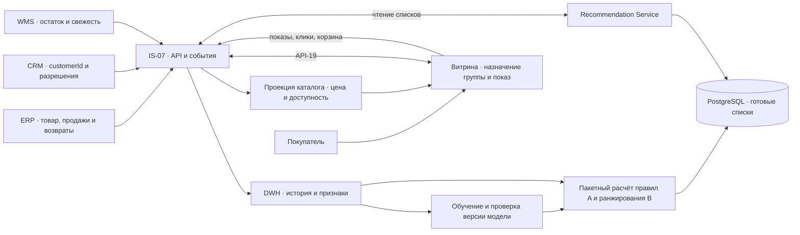

# EC-AI-001. Товарные рекомендации для интернет-магазина RetailMax

| Поле | Значение |
| --- | --- |
| Версия и дата | 1.0 · 26.11.2026 |
| Статус | Учебный проект внедрения |
| Процесс | BP-04 «Интернет-продажи», IS-03 «Интернет-магазин» |
| Владельцы | Команда 4 отвечает за пользовательский сценарий и пилот. Команда 5 отвечает за данные, модель и Recommendation Service |
| Основания | [Проблема EC-P-08](../01_Business_Architecture/Requirements/EC-PRB-001-problems.md), [REQ-EC-010](../01_Business_Architecture/Requirements/requirements.md), [стратегия DOC-08](../../00_Documentation/DOC-08.md), [интервью DOC-11](../../00_Documentation/DOC-11.md), [AI-01 из DOC-12](../../00_Documentation/DOC-12.md) |

## Бизнес-задача и сценарий

Покупатели ожидают релевантных товарных рекомендаций. В текущем процессе нет описанного цикла от расчёта до показа и оценки результата. Для пилота выбран один сценарий. Покупатель открывает карточку ноутбука и видит блок «Подойдёт к этому товару» с доступными совместимыми аксессуарами. Кандидаты берутся из каталога, а порядок может учитывать покупки и интересы клиента при действующем разрешении. Для гостя, нового клиента без истории или клиента с запретом персонализации применяются контекстные правила.

Цель — увеличить маржинальный доход в расчёте на покупателя, допущенного в эксперимент, за счёт полезных допродаж при сохранении качества оформления заказа. Команда 4 управляет показом блока и экспериментом, команда 5 — алгоритмом и качеством данных, коммерческий отдел — правилами совместимости и ассортиментом пилота, финансы — расчётом маржи, безопасность и владелец CRM — условиями работы с данными. Первая очередь ограничена карточками выбранных категорий на сайте. Корзина, главная страница, POS и маркетинговые рассылки относятся к последующим очередям.

## Выбор решения

| Вариант | Что увидит покупатель | Польза и ограничение |
| --- | --- | --- |
| Текущий сценарий без нового блока | Обычная карточка товара | Отсутствуют дополнительные затраты и данные для оценки рекомендательного блока |
| **A. Обычная автоматизация** | Совместимые аксессуары, упорядоченные по частоте совместных покупок с данным товаром, при малой истории — по популярности в категории | Прозрачный и быстрый запуск. Одинаковый порядок для покупателей в одном контексте |
| **B. Машинное обучение** | Тот же блок и тот же способ построения кандидатов, порядок уточняет модель по контексту и разрешённой истории | Учитывает сочетания интересов, характеристик и истории. Требует обучающих данных, версий, контроля качества и дополнительного OPEX |

Сначала запускаем правила A как контроль и резервный режим. Затем проверяем B с помощью временного теста и A/B-пилота. Кандидат для B — CatBoostRanker с ограниченным набором признаков. Он подходит для табличных данных каталога и покупок, а пакетный расчёт позволяет использовать общий для A и B контракт. При небольшом объёме истории может не хватить данных для надёжного обучения и проверки эффекта. В этом случае магазин использует правила, а команда уточняет экономику самостоятельного запуска блока A.

## Логическая архитектура To-Be

Решение развивает [ADR-EC-004](../05_Architecture_Decisions/ADR/ADR-EC-004-product-recommendations.md) и использует существующий проектный маршрут через [IS-07](../../06_integration_architecture/INT-001-target-model.md). Один Recommendation Service и его PostgreSQL-схема принадлежат команде 5. Витрина магазина управляет показом и экспериментом.

**Расчёт.** Для товара строим пул совместимых активных аксессуаров по связям каталога и статистике покупок. Для B модель ранжирует этот же пул. Признаки пилота — категория и совместимость, частота совместных покупок, давность и частота интереса к категории при наличии разрешения. После теневой проверки фоновый расчёт обновляет готовые наборы раз в час. Действие набора ограничено двумя часами по ADR-EC-004. Расчёт B ограничен категориями пилота и парами «покупатель × контекст товара», которые встречаются в разрешённой недавней истории. Для отсутствующей пары применяется A. Применимость такого ограничения проверяется по покрытию и времени расчёта. Кандидатный пул ограничивается заранее согласованным размером, чтобы нагрузка росла пропорционально числу отобранных пар.

**Публикация.** Пакетная задача записывает версию модели, границу истории, генерацию и списки с `productId`, `rank`, `placement` и ключом контекста. После проверки полноты списков и отсутствия дублей отдельная транзакция переключает активный указатель. Незавершённый выпуск остаётся скрытым. Версия хранится вместе с метриками, настройками и датой среза. На старте переобучение планируется раз в неделю. Публикация новой версии проходит через проверку качества и теневой прогон.

**Выдача.** После открытия карточки шесть позиций загружаются отдельным запросом, независимо от основной страницы. Витрина присваивает группу на сервере и через IS-07 читает действующий набор. Перед показом она исключает дубли, текущий товар, несовместимые, неактивные и недоступные позиции. Цена и доступность берутся из действующих проекций каталога, резерв подтверждается WMS при оформлении. При таймауте или пустом наборе витрина использует действующий контекстный список с той же проверкой наличия, иначе скрывает блок.

## Данные, интерфейсы и доступ

| Поток | Состав и назначение | Владелец и контроль |
| --- | --- | --- |
| Каталог и доступность | `productId`, категория, статус, связи совместимости, цена и актуальная проекция наличия. `EVT-01`, `EVT-04`, действующие контракты каталога | ERP и коммерческий отдел владеют товаром и ценой, WMS — остатком. Витрина применяет фильтры перед показом |
| Покупки и возвраты | Онлайн-факты `EVT-17` и `EVT-18`, связка строки заказа, суммы после скидок и возвратов, данные о переменных затратах из согласованной финансовой витрины | ERP и финансы. Дедупликация по финансовому факту и строке, возврат связывается с исходной продажей |
| Поведение и эксперимент | Просмотр карточки, фактический показ блока, клик, добавление в корзину. Для связки нужны `eventId`, время, `placement`, контекстный и рекомендованный `productId`, позиция, `setId`, `generationId`, группа и версия эксперимента | Витрина публикует через IS-07, команда 5 хранит разрешённые события. Контракт телеметрии согласуется до пилота. Назначение группы регистрируется до выдачи, повтор события дедуплицируется по `eventId` |
| Разрешение | Подтверждённый `customerId` из серверной сессии, `scope`, `allowed`, версия и время действия разрешения. Изменения доставляет `EVT-22` | CRM и владелец данных. Проверка разрешения на обучение и выдачу. При неизвестном или устаревшем статусе используется контекстный набор |
| Выдача | `API-19 GET /recommendations/v1/sets` через IS-07. Вход — место и контекст, ограничение числа позиций и проверенный серверный `customerId` при разрешении. Внутреннее доверенное назначение A/B согласуется в контракте. Выход — упорядоченные `productId`, ранг, идентификаторы набора и генерации, версия алгоритма, `validUntil` | Команда 5 владеет контрактом и PostgreSQL, команда 4 отображением. Права чтения и записи раздельные |

Все обмены используют сервисные права и TLS. В браузер передаются карточки и идентификатор показа, достаточный для телеметрии. Контакты и платёжные данные в расчёт не входят. При отзыве разрешения персональная выдача прекращается, списки инвалидируются, а снятая версия запрещается также при откате. Владелец данных согласует сроки хранения и процедуру удаления из признаков, наборов и будущих обучающих выборок. Удаление или переобучение уже выпущенной модели выполняются по согласованной процедуре обработки запросов. [Каталог контрактов IS-07](../../06_integration_architecture/INT-002-contract-catalog.md)

## Качество, A/B-пилот и приёмка

**До показа.** Сначала собираем телеметрию правил A. Для обучения используем доступные на момент показа признаки. Покупки, сохранившиеся после окна возвратов, получают более высокий вес, чем добавления в корзину. Отрицательные примеры берём среди реально показанных позиций без целевого действия. Обучение, настройка и проверка разделены по времени. Для сравнения A и B на отложенной выборке считаем NDCG@6 на наблюдаемых показах, отдельно смотрим категории с редкими покупками и покрытие доступным набором. Проектный порог для допуска в теневой режим — рост NDCG@6 от 5% относительно A при ненулевой базовой метрике и без ухудшения согласованных срезов. Логи A смещены в пользу показанных товаров, поэтому офлайн-метрики используются для отбора модели, а результат подтверждается экспериментом.

**Пилот.** В момент первого подходящего просмотра делим 50/50 по стабильному ключу авторизованного клиента с действующим разрешением в пилотных категориях. Человек с назначенной группой остаётся в её знаменателе при пропуске выдачи или срабатывании резерва. Положение блока, число мест и правила фильтрации одинаковы. Основная метрика — маржинальный доход всех онлайн-заказов клиента за семь дней после назначения, с учётом возвратов, в среднем на каждого рандомизированного клиента, включая клиентов без заказов. Такой расчёт учитывает замещение между товарами. CTR, добавления в корзину и средний чек нужны для диагностики. Финансы согласуют окно дозревания возвратов. Для дорожной карты заложены 30 дней после окончания семидневного окна как оценка времени ожидания.

До старта аналитик оценивает дисперсию маржи по покупателям и поток подходящих участников на данных A. Размер выборки и срок фиксируются для двустороннего уровня значимости 5%, мощности 80% и минимального целевого эффекта около порога ТЭО. Плановые четыре недели — оценка набора, которую пересчитывают по фактическому трафику. Итог сравнивают после набора и дозревания. Для перехода к ограниченному тиражированию нужны положительная нижняя граница 95% доверительного интервала, точечная оценка не ниже пересчитанного порога **2,42%** в исходных допущениях и пройденные защитные метрики. Если интервал пересекает финансовый порог, оценку считают неопределённой для полного тиража и сохраняют ограниченный показ или подтверждают эффект на новой выборке.

| Проверка | Предлагаемый критерий допуска или действие |
| --- | --- |
| Скорость и изоляция | p95 сквозной выдачи `API-19` до 150 мс на нагрузочном стенде, жёсткий таймаут блока 250 мс. Блок загружается отдельно. При принудительном отказе выдачи оформление и оплата продолжаются, SLO магазина 99,9% из DOC-17 сохраняется |
| Нагрузка | Прогон для профиля 600 одновременных пользователей магазина из DOC-10 с измеренной частотой открытий карточек и одновременным пакетным расчётом. Пакет укладывается в интервал 60 минут. Для обоих вариантов проверены повторная запись и переключение версий |
| Качество показа | Проверены активность, совместимость и наличие. Отклонения конверсии в заказ, возвратов и задержки карточки сравниваются с A по заранее утверждённым допускам. Доля контекстного резерва измеряется отдельно для B |
| Эксплуатация и приватность | Дашборд показывает задержку, ошибки, возраст генерации, долю резерва, покрытие и состав признаков. Сигнал дежурному при пропущенной генерации и истечении наборов. Проверены отказ API/БД, переключатель B → A, отзыв разрешения и невозможность чтения чужого списка |
| Достоверность эксперимента | Сходится распределение групп, отложенные финансовые факты привязаны однозначно, события не дублируются, окно возвратов закрыто. При нарушении данные пилота перепроверяются до принятия решения |

Численные проектные пороги, кроме исходных требований кейса, согласуются на этапе обследования. Для приёмки применяются также сценарии T-27 и T-28. [Сквозная приёмка IS-07](../../06_integration_architecture/INT-004-acceptance.md)

## Внедрение и контрольные точки

| Этап от старта | Результат и условие перехода | Кто принимает |
| --- | --- | --- |
| Недели 1–2. Обследование | Выбраны категории и владельцы. Проверены история, связывание строк ERP, разрешения, экономика и жизнеспособность A/B. Согласованы API-19 и события. Доступны маршруты IS-07, витрины команды 5 и проекции сайта | Команды 4 и 5, ИТ, финансы, владелец CRM |
| Недели 3–6. Правила и сбор данных | Блок A под флагом, события показов и назначений, измерения маржи, фильтры и безопасный резерв. Пройдены стендовые проверки, владельцы умеют отключать блок | E-commerce, команда 5, эксплуатация |
| Недели 7–8. ML и теневой расчёт | Готова версия модели с временным тестом, пройдены проверки доступа, нагрузки, смены поколения и отката. При нехватке пригодной истории сбор продолжается, витрина использует A | Команда 5 и эксплуатация |
| Недели 9–12. A/B | Набор выборки среди подходящих клиентов. При срабатывании защитных метрик флаг B выключается, данные причины сохраняются | Владелец e-commerce и аналитик |
| Недели 13–18. Дозревание и решение | Закрыты окна покупок и возвратов. Согласованы эффект, порог NPV и фактические затраты, принято решение о масштабе | E-commerce, аналитик, финансы |
| Недели 19–20. Поэтапный выпуск | Увеличение охвата и наблюдение за защитными метриками. Эксплуатация получает инструкцию, проводит проверку отключения. Коммерция обучена управлению категориями и правилами совместимости | E-commerce, коммерция и эксплуатация |

Двадцать недель — оценка после готовности зависимостей. Фактические объём истории и мощность пилота определят срок. Этапы включаются в общий 12-месячный план программы. Статус решения фиксируется после приёмки.

## Риски и действия

| Риск | Вероятность | Влияние | Действие и владелец |
| --- | --- | --- | --- |
| R1. Недостаточно качественной истории или мощности пилота | Высокая | Высокое | До A/B сверить финансовые и поведенческие события, оценить допустимый срок набора. Если мощности не хватает, собрать историю и держать A. Команда 5 |
| R2. Прирост ниже порога ТЭО или замещение продаж | Средняя | Высокое | Использовать маржу всех онлайн-заказов и актуальную смету. При отрицательном результате отключить B. E-commerce и финансы |
| R3. Нарушение разрешений или утечка списка | Низкая | Высокое | Проверять правило доступа в выдаче, отзыве и откате. При инциденте отключить персонализацию. Владелец CRM и безопасность |
| R4. Сбой генерации или деградация сайта | Средняя | Высокое | Изолировать ресурсы выдачи, настроить таймаут, флаги и проверенный контекстный резерв. Эксплуатация |
| R5. Неактуальная доступность или ошибки совместимости | Средняя | Среднее | Фильтровать перед показом, при неподтверждённой доступности скрывать позицию. Коммерция и e-commerce |

| Вероятность ↓ / Влияние → | Низкое | Среднее | Высокое |
| --- | --- | --- | --- |
| Высокая | — | — | **R1** |
| Средняя | — | R5 | **R2, R4** |
| Низкая | — | — | R3 |

Высокий приоритет получают риски с высоким влиянием и средней либо высокой вероятностью. Для нарушения доступа действует немедленное отключение персонализации независимо от оценённой вероятности.

## Экономика и связь с заданием

Учебная смета ML-варианта составляет **46 000 у.е.** инвестиций и **12 000 у.е.** дополнительных расходов в год. При приросте маржи в охваченном сегменте **2,7%** пятилетний NPV составляет **10 535 у.е.**, окупаемость — **3,48 года** после старта эксплуатации. Прирост и покрытие являются допущениями. При относительном приросте 1% полного денежного эффекта для окупаемости проекта не хватает. [ТЭО, альтернативы и пороги](TCO_ROI/EC-ECO-001-recommendation-business-case.md)

| Практика | Где смотреть |
| --- | --- |
| 6. Внедрение ИИ | Проблема EC-P-08, пользовательский сценарий, сравнение правил и ML, схема, интерфейсы, меры безопасности и [ADR-EC-004](../05_Architecture_Decisions/ADR/ADR-EC-004-product-recommendations.md) |
| 7. ТЭО | [Смета альтернатив, пятилетний поток, ROI, NPV, IRR, PI, окупаемость и чувствительность](TCO_ROI/EC-ECO-001-recommendation-business-case.md) |
| 8. Риски и план | Этапы, критерии перехода, владельцы и план реагирования в этом документе |

Структура анализа ИИ и критериев допуска взята у команды склада. Интеграция с аналитикой и сценарий интернет-магазина развивают требование AI-RET-04 команды 5. [Практики команды склада](https://github.com/rsingatulin/hse_architecture/blob/c9012af93485062601fdc2f300b73221184a7889/03_warehouse_domain/07_Project_Management/WH-PM-006-practice-audit.md) · [Требования Retention](../../05_retention_domain/01_business_context/Архитектурные_требования.md)
