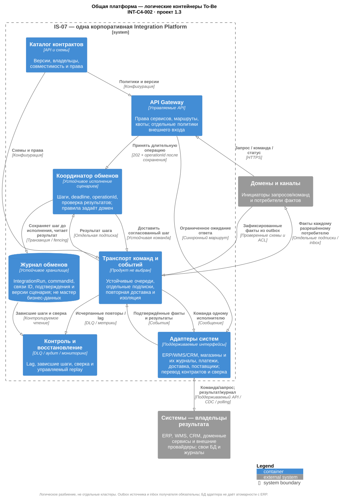
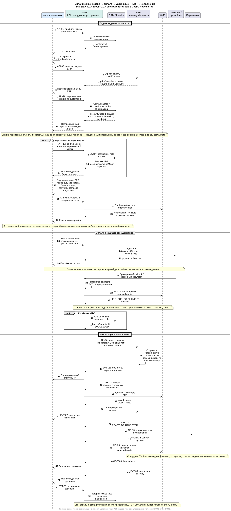

# INT-001 — как работает общая интеграция RetailMax

**Версия 1.0 · 12.11.2026 · Предложено для согласования**

## 1. Задача и результат

Командам нужна одна модель межсервисного взаимодействия: кто принимает решение, кто хранит результат, каким сообщением он передаётся и что происходит при сбое. Общая платформа должна заменить несогласованные связи, обеспечить восстановление обменов и позволить независимо развивать домены.

В целевой модели есть один корпоративный контур Integration Platform. Он обслуживает все пять доменов, ERP, CRM, WMS, платежи, доставку, поставщиков и каналы коммуникаций. Внутри одного приложения модули могут вызывать друг друга и работать со своим хранилищем. Отдельно развёрнутые сервисы используют общий слой; доступ к чужой БД запрещён.

Цель первой версии — сквозной заказ центрального склада, закупка/приёмка, продажа POS с доставкой фактов, общая история клиента и аналитические подписки. Самовывоз, распределённый резерв по магазинам и полностью автономное списание бонусов требуют отдельных контрактов. Этот пакет задаёт границы этих расширений, но не обещает их готовности.

## 2. Что уже задано, а что предлагается

| Решение | Основание / статус |
|---|---|
| Один общий слой, API + события + адаптеры, техническая координация и восстановление | ADR-EC-001 v1.3; наличие общего слоя — договорённость команды от 22.10.2026 |
| WMS подтверждает атомарный резерв до оплаты; ERP создаёт задание с тем же reservationId | ADR-EC-002 и проект WH-API-001 |
| CRM — мастер профиля и customerId; Customer Data Hub и общий MDM исключены | Решение команды в ADR-EC-003 v1.2; модель Retention ещё требует корректировки |
| Рекомендации предрассчитывает команда 5, готовые списки хранятся в PostgreSQL | Предложение ADR-EC-004; новый пакет сохраняет этот вариант |
| Удержание оплаченного резерва, возврат при позднем платеже, финансовый источник начислений, автономный режим POS | **Новые предложения этого пакета**; принять совместно по INT-003 |
| Продукт брокера, Gateway, физическая топология и персональные ответственные | Выбираются после проверки IS-07, нагрузки и общей стоимости; названия продуктов не зафиксированы |

## 3. Устройство общей платформы

| Логический компонент | Назначение и данные | Кто отвечает |
|---|---|---|
| API Gateway | Аутентификация сервисов, маршрутизация, квоты, техническая валидация; публичный и внутренний входы разделены политиками | Эксплуатация платформы |
| Транспорт команд и событий | Устойчивый приём, доставка с возможными повторами, отдельные подписки, изоляция потоков | Эксплуатация платформы |
| Координатор обменов | Сохраняет шаги IntegrationRun, подтверждения, deadlines, связь commandId/orderId/erpOrderId/reservationId/taskId; возобновляет обмен | Платформа реализует; владельцы доменов утверждают последовательность и бизнес-правила |
| Адаптеры систем и провайдеров | Перевод контрактов в поддерживаемые интерфейсы; webhook, журнал/CDC при поддержке системы, контрольные снимки | Команда владельца системы за семантику, платформа за исполнение |
| Каталог API и схем | Владелец, версии, разрешённые потребители, примеры, совместимость | Координатор e-commerce ведёт реестр; каждый домен владеет своими контрактами |
| Журнал обработки, карантин и сверка | Состояния доставки, ссылки на результат, причины ошибок, replay с аудитом | Платформа + дежурный домена |

Это логические границы, а не заказ шести новых продуктов. Сначала проверяются возможности IS-07. Gateway не хранит бизнес-заказ, брокер не принимает бизнес-решения, журнал интеграции не заменяет ERP и CRM. Для координатора нужны устойчивое состояние, защита от конкурентного исполнения шага и сохранение версии сценария для уже запущенных обменов.

Интернет-магазин владеет правилами оформления и своим заказом канала. В платформе выполняется согласованный сценарий обмена; отдельный новый оркестратор e-commerce не требуется. ERP самостоятельно решает, когда её учётный заказ позволяет выпустить складское задание. Координатор доставляет эту команду ERP, но не создаёт конкурирующее задание от имени магазина.

## 4. Три режима обмена

| Режим | Когда применять | Что означает ответ | Примеры |
|---|---|---|---|
| Запрос / немедленная команда | Пользователю нужен авторитетный результат до следующего действия | Ответ бизнес-системы; сетевой таймаут оставляет результат неизвестным | Расчёт цены, резерв, подтверждение bonus hold, customerId |
| Устойчивая отложенная команда | Операция может завершиться после ответа вызывающему | `202` + operationId означает только сохранённое поручение; результат читается отдельно | Регистрация оплаченного заказа ERP, задание WMS, возврат денег |
| Событие | Факт уже зафиксирован владельцем | Подтверждение транспорта не означает, что все подписчики применили факт | Изменение Stock, приёмка, продажа, доставка |

Синхронный маршрут: инициатор → Gateway → адаптер → владелец результата → ответ тем же путём. Долговременное ожидание не удерживает HTTP-соединение: команда сохраняется, возвращается operationId, подписка/опрос получает итог. Событийный маршрут: транзакция источника и outbox/поддерживаемый журнал → транспорт → отдельная подписка → inbox и изменение у потребителя.

Команда адресована одному исполнителю и выражает намерение. Событие описывает факт и допускает несколько потребителей. Запросы на резерв нельзя выдавать за события успешного резервирования. `202 Accepted` не подтверждает завершения обработки — это соответствует [HTTP Semantics, §15.3.3](https://www.rfc-editor.org/rfc/rfc9110.html#section-15.3.3).

## 5. Владельцы и границы сервисов

| Область | Единственная авторитетная запись | Допустимые копии и взаимодействия |
|---|---|---|
| Товар и базовая цена | ERP; бизнес-владелец — коммерческий отдел | Product Catalog в каналах — проекция ERP; WMS получает товарные реквизиты |
| Итоговая цена с акциями | Предлагается единый Pricing & Promotion Service, ответственный коммерческий отдел / ERP | Базовая цена из ERP, версии разрешённых акций Campaign; один quoteId для расчёта. Это логическая функция, размещение согласуется |
| Профиль и бонусный счёт | CRM; маркетинг / команда 5 | Loyalty применяет бонусные правила через поддерживаемую транзакцию CRM. Самостоятельный второй баланс не создаётся |
| Заказ канала | E-commerce | Корзина, выбранные позиции, price snapshot, customerId, состояния оформления; связь с erpOrderId |
| Учётный заказ, закупка, поставщик, финансовое отражение | ERP | Закупочные сервисы — логические функции домена; копии в аналитике и исполнении |
| Центральный остаток, резерв, приёмка, задание, отгрузка | WMS | ERP и сайт читают версии WMS; не изменяют остаток по другим событиям |
| Продажа POS и магазинный запас | POS и Inventory Service команды 1 — предлагаемый владелец запаса магазина | locationType=STORE; SaleCompleted не списывает центральный склад WMS |
| Платёж / возврат | Внешний провайдер — факт расчёта; ERP — финансовый учёт | Адаптер сохраняет подтверждённый результат и привязку к orderId/paymentId; магазин хранит проекцию |
| Доставка | Перевозчик — факт доставки; WMS — факт физической передачи | Один shipmentId/trackingId, разные события «передано» и «доставлено» |
| Аналитика и рекомендации | Команда 5 владеет производными витринами и списками рекомендаций | Не изменяют операционный остаток, финансовый факт, профиль или бонусы |

Identity/SSO отвечает за вход и subject, CRM — за customerId. Соответствие subject ↔ customerId подтверждается CRM и сохраняется в канале. Роль кассира и владение профилем проверяются получателем, даже если Gateway уже проверил токен.

Campaign Service задаёт маркетинговые кампании, разрешения и версии акций, а не редактирует базовую цену ERP. Recommendation Service выдаёт productId с версией/сроком списка; цена и наличие добавляются каталогом. Procurement Planning создаёт предложения закупок, Delivery Control сверяет поставку, Supplier Integration работает как часть общего слоя. Аналитический прогноз не превращается автоматически в заказ поставщику.

## 6. Онлайн-заказ: основной маршрут

1. Витрина показывает локальную проекцию товара, цены и доступности с sourceVersion/asOf. Устаревшая копия не даёт гарантии наличия.
2. Для нового клиента канал получает customerId CRM через платформу; до подтверждения новая регистрация остаётся PROFILE_LINK_PENDING. Для известного клиента допустима сохранённая подтверждённая связь и действующая сессия.
3. Сервис заказа сохраняет orderId/orderVersion, получает quoteId/validUntil и снимок состава/цены. Изменение суммы требует подтверждения покупателя. При использовании бонусов Loyalty атомарно удерживает согласованную сумму в CRM и возвращает bonusHoldId; без авторитетного результата бонусы не вычитаются.
4. WMS атомарно резервирует все строки центрального склада. Канал сохраняет reservationId/version/expiresAt. До подтверждения резерва платёж не создаётся. Срок резерва покрывает окно начала оплаты; срок платежной сессии и bonus hold не должен превышать разрешённое окно без согласованного продления.
5. Платёж создаётся с устойчивым paymentAttemptId и ключом повтора. Пользователь может перейти на страницу провайдера; подтверждением служит проверенный серверный результат, а не редирект браузера.
6. После подтверждённого платежа координатор вызывает **предлагаемую** команду WMS `confirm-paid`: ACTIVE → HELD_FOR_FULFILLMENT, только если резерв ещё действителен. WMS сохраняет paymentId и защищает переход от гонки с истечением. После удержания обычный TTL больше не освобождает товар; есть deadline разбора, мониторинг и явная компенсация владельца заказа.
7. Если применены бонусы, подтверждается списание прежнего bonusHoldId. Потеря ответа требует проверки прежней операции. Неуспешное списание после денежной оплаты переводит заказ в урегулирование; сумму нельзя молча менять. Регистрация ERP начинается после подтверждённых компонентов оплаты.
8. Платформа устойчиво передаёт оплаченный заказ ERP. После бизнес-подтверждения ERP выпускает единственное задание WMS с прежними orderId/orderVersion/reservationId. WMS переводит резерв в ALLOCATED, не резервируя повторно.
9. После готовности к передаче координатор по правилам интернет-магазина заказывает доставку через адаптер. WMS фиксирует фактическую передачу, перевозчик — доставку клиенту. События обновляют статус заказа; запрос доставки сам по себе не означает отгрузку.
10. CRM и BI независимо получают историю. ERP публикует отдельный подтверждённый финансовый факт `erp.sale.posted.v1`; Loyalty начисляет бонусы по нему, один раз на saleId. Платёж, складская отгрузка и SaleCompleted не считаются тремя продажами.

## 7. Состояния и компенсации

Состояния ниже — проект согласованной логики, не описание внедрённой машины состояний. Платформа хранит технический ход, домены — свои объекты. Универсального статуса «заказ обработан» нет.

| Контрольная точка | Источник подтверждения | Следующее допустимое действие / исключение |
|---|---|---|
| PROFILE_READY / QUOTED | CRM / Pricing | Можно запросить резерв; истёкшую цену пересчитать до оплаты |
| RESERVED | WMS: ACTIVE + expiresAt | Начать платёж; при отказе до оплаты освободить резерв и bonus hold |
| PAYMENT_UNKNOWN | Провайдер ещё не дал определённого результата | Опросить прежний paymentAttemptId; не создавать повторное списание |
| PAID_HOLD_PENDING | Провайдер подтвердил оплату | Вызвать confirm-paid; подтверждение оплаты не доказывает сохранность резерва |
| PAID_HELD | WMS: HELD_FOR_FULFILLMENT | Подтвердить bonus hold, затем передать в ERP; простой ERP не освобождает товар |
| ERP_REGISTERED | ERP: erpOrderId и версия | Только ERP инициирует задание WMS |
| FULFILLMENT_ACCEPTED | WMS: taskId, резерв ALLOCATED | Подбор; отмена проходит через cancel task и подтверждённый возврат отобранного |
| HANDED_OVER / DELIVERED | WMS / перевозчик, раздельно | После передачи нужна процедура возврата; простая release недопустима |
| COMPENSATION_PENDING | Владелец процесса инициировал урегулирование | Завершить отмену исполнения, release/bonus reversal/refund по подтверждённым результатам |
| CANCELLED / REFUNDED | Все требуемые компенсации подтверждены | Терминальный исход; транспортный ACK не закрывает компенсацию |

**Поздний платёж:** если `confirm-paid` подтверждённо отклонён из-за истёкшего резерва, предлагается отменить исполнение и вернуть деньги тем же paymentId. Новый резерв автоматически не создаётся. Это консервативное бизнес-правило должно быть принято e-commerce, WMS и финансами. При таймауте confirm-paid сначала проверяется состояние: неизвестный результат нельзя считать отказом.

**ERP недоступна после оплаты:** заказ остаётся PAID_HELD, команда повторяется с тем же ключом. При превышении согласованного deadline владелец заказа принимает решение о продолжении или компенсации. До release требуется исключить позднее создание задания: отменить/заблокировать заказ ERP, получить финальный результат уже отправленного задания либо выполнить cancel task. Удержание, версии и разрешение отмены проверяются WMS атомарно. Простая отмена сообщения в очереди не гарантирует отмены уже выполненного действия.

Если отмена пришла в ERP раньше регистрации, ERP сохраняет запрет по внешним orderId/orderVersion даже без созданного учётного заказа. Запоздалый API-10 не должен обойти этот запрет. Это часть предлагаемого API-21, которую необходимо подтвердить у владельца ERP.

**Возврат после передачи:** отдельный returnId, факт возвратной приёмки WMS, финансовое сторно ERP и подтверждённый refund провайдера. Приёмка возврата не означает автоматическую доступность: WMS определяет пригодность и публикует новый Stock. Loyalty сторнирует начисление по исходному saleId/returnId; consumer не меняет баланс самостоятельно.

Возврат ранее **списанных** бонусов выполняется отдельной авторитетной операцией API-27 по bonusOperationId. Это другой эффект, чем сторно **начисления** по EVT-18. Незавершённый hold освобождается API-18; уже списанный hold нельзя вернуть командой release. При частичном возврате сумма каждого эффекта ограничена исходной операцией и возвращёнными строками. Заказ остаётся COMPENSATION_PENDING, пока не подтверждены все требуемые части возврата.

## 8. Закупки, POS, аналитика

**Закупки.** ERP передаёт поставщику согласованный заказ через Supplier Adapter и сохраняет supplier acknowledgement. Ожидаемая поставка с purchaseId/expectedReceiptId/version поступает WMS отдельной командой. Каждая фактическая приёмка создаёт свой receiptId/movementIds. Delivery Control суммирует уникальные принятые строки; частичная поставка оставляет закупку открытой до остатка или согласованного досрочного закрытия. Приёмка и Stock — разные факты; подтверждение поставщика не увеличивает запас.

**POS.** При связи касса получает разрешённые цены и авторитетное подтверждение бонусной операции. При потере связи предлагается продажа без списания бонусов, по допустимым локальным правилам цен; начисление откладывается до ERP-факта. Проверка неизвестного платежа предшествует новой попытке оплаты. Чек и намерение отправить SaleCompleted сохраняются атомарно/в восстанавливаемом журнале. Фискализация и локальный терминал остаются в ответственности POS; внутренние аппаратные вызовы не требуют кругового обращения в центр.

**Магазинный запас.** POS Inventory списывает только STORE-локацию по saleId. WMS ведёт CENTRAL-локацию. Передача со склада в магазин — связанная пара движений transferId, а не повторное списание центрального запаса при продаже на кассе. Владельца STORE-остатка нужно подтвердить с продажами и Warehouse до самовывоза.

**Аналитика.** У каждого потребителя своя подписка. DWH принимает факты POS, ERP, WMS, CRM, поведения и доставки; финансовую выручку считает по ERP-факту, складской запас — по WMS. Историческая загрузка и сверочные снимки идут через управляемый адаптер с boundary/watermark и дедупликацией, а не параллельным вторым потоком начислений. BI читает витрины. Рекомендации читают разрешённые подготовленные данные, предрассчитываются раз в час и выдаются из PostgreSQL со сроком два часа — проектные параметры ADR-EC-004. Недоступность рекомендации скрывает блок или включает действующий неперсональный резервный список, не блокируя checkout.

## 9. Надёжность, права и эксплуатация

| Ситуация | Обязательное поведение |
|---|---|
| Запись произошла, отправка упала | Outbox в транзакции источника либо поддерживаемый журнал/CDC и сверка. Отдельная БД адаптера не даёт атомарности с ERP |
| Повтор команды | Ключ `(clientId, operationType, idempotencyKey)` и hash тела; прежний результат либо `409` для изменённого тела. Дополнительно уникальный бизнес-ID |
| Повтор события | Inbox/eventId и бизнес-изменение фиксируются одной транзакцией; внешнее побочное действие получает свой устойчивый ключ |
| Пропуск / нарушение порядка | Порядок в пределах `(source, aggregateType, aggregateId)`; старая версия не откатывает новую. Для неполного потока нельзя требовать версии +1: контракт определяет full snapshot или delta и восстановление |
| Временный сбой | Один исполнитель повторов на шаг; ограниченный exponential backoff с jitter, Retry-After, лимит по deadline |
| Бизнес-отказ / неверные данные | Нет бесконечного retry: конечный результат или карантин с ответственным |
| DLQ и replay | Сохранение ID, причины и исходной версии схемы; разрешённый replay с аудитом; просроченные бизнес-команды проходят повторную проверку условий |
| Сбой аналитики / маркетинга | Отдельные очереди и квоты; не блокирует резервирование, оплату и регистрацию |
| Восстановление из backup | Сверка с источниками и восстановление курсоров/ключей до replay; нельзя восстановить данные без согласованного состояния дедупликации |

Outbox обеспечивает связь локального изменения и намерения отправить факт; транспорт всё ещё может доставлять повторы. Поэтому получатель также защищает бизнес-эффект. Основания: [Transactional Outbox](https://microservices.io/patterns/data/transactional-outbox.html), [Idempotent Consumer](https://microservices.io/patterns/communication-style/idempotent-consumer.html). Срок хранения ID должен покрывать максимальное окно replay, восстановления и поздних внешних уведомлений; конкретные сроки утверждаются до запуска.

Доступ назначается по операции: онлайн может reserve, но не confirm-handover; BI может читать события, но не выпускать задания; профиль нельзя менять произвольным customerId. Каналы используют TLS, сервисные идентификаторы и ограниченные scopes. Внешние webhook проверяются на подлинность и повтор, при сомнении результат уточняется у провайдера. В общих событиях нет PAN/CVV, полных контактов и адресов; необходимые данные исполнения передаются в защищённых командах конкретным исполнителям. Логи содержат correlationId и бизнес-ID, без платёжных реквизитов. Согласия, удаление и персонализация распространяются на проекции и откат рекомендаций.

Эксплуатация наблюдает p95/p99 API, возраст старейшего сообщения, lag каждого потребителя, ошибки адаптеров, DLQ, зависшие IntegrationRun, оплаченные удержания без задания, неизвестные платежи и результаты сверки. Для каждого алерта есть владелец платформы и бизнес-владелец. Метрики бизнес-сроков измеряются отдельно от доставки сообщения.

## 10. Нефункциональные требования и ограничения

| Показатель | Основание / проектное решение |
|---|---|
| Критичный API ≤500 мс; пользовательская операция ≤3 с | DOC-17; границы API включают Gateway и адаптер. Для пилота предлагается p95, p99 отчётно; процентиль ещё требует согласования |
| Техническая обработка заказа ≤5 с | DOC-17; предлагаемый интервал — сохранение принятого запроса и результат начальных проверок; ожидание действий покупателя/3DS не входит. Нужна явная приёмка этой трактовки |
| Бизнес-обработка заказа ≤10 минут в среднем | REQ-EC-003; предлагаемые границы — подтверждённая оплата → принятое задание WMS, физическая комплектация отдельно |
| Бонусы на кассе ≤200 мс | Требование Retention BR-RET-04/07; прежний таймаут POS 2 с не соответствует. Предлагается ≤200 мс до подтверждения либо ответа «без списания»; кэш не подтверждает списание |
| Свежесть витрин ≤15 минут | Требование Retention DA-RET-02; от occurredAt авторитетного факта до доступности в витрине; длительность построения отчёта ≤1 минуты измеряется отдельно |
| Свежесть проекции Stock | Предлагаемый пилотный бюджет p95 ≤60 с, предупреждение при asOf старше 120 с; окончательные пороги согласуются. Проверка наличия при оплате всегда через WMS |
| Доступность сайта 99,9%; ERP/WMS 99,5%; CRM 99% | DOC-17. Нельзя обещать checkout 99,9% при обязательной синхронной зависимости от WMS 99,5%. Согласовать повышение доступности зависимостей или отдельные SLO просмотра/оформления |
| RTO ≤4 ч, RPO ≤1 ч | Общий предел DOC-17. Для подтверждённо принятых команд предлагается отсутствие потери при отказе одного узла; аварийное восстановление сверяется с источниками платежей/заказов. Backup RPO сам по себе не гарантирует отсутствие потери оплаты |
| Рост до 2 млн заказов в год и +50% пользователей | DOC-17; это ростовой сценарий, не RPS. Пиковая нагрузка, сообщения на заказ, акции и длительность буфера измеряются до выбора брокера |

## 11. Альтернативы и риски

| Вариант | Оценка |
|---|---|
| Прямые API между всеми системами | Простое начало, но повторяет текущую проблему связности и не соответствует общей договорённости |
| Только синхронный Gateway | Общая точка доступа есть, но долгие цепочки зависимы от доступности всех участников; нет устойчивого восстановления |
| Только события для всего | Развязывает обработку, но усложняет немедленное подтверждение резерва/цены; пользователь не может платить по неподтверждённому факту |
| Общая платформа с API, командами, событиями и адаптерами | Выбрана; требует устойчивого журнала, эксплуатации, договорённостей владельцев и изоляции потоков |

| Риск | Влияние / мера |
|---|---|
| Общая платформа становится общей точкой отказа | Резервирование, независимые пулы критичных и аналитических потоков, квоты и проверка failover |
| Legacy не поддерживает безопасный повтор | Не объявлять адаптер решением проблемы: поддерживаемое расширение, журнал результата или контролируемый разбор UNKNOWN |
| Удержания занимают склад навсегда | Deadline, алерт, регулярная сверка и явная компенсация после проверки ERP/WMS |
| Мастер-логика утекает в платформу | В платформе только ход обмена; владельцы утверждают правила и подтверждают каждый бизнес-переход |
| Несколько реализаций цен, баланса или выручки | Один авторитетный результат на тип данных, каталог контрактов и тест на двойной эффект |
| Расходы на общие компоненты учтены пять раз | Единая строка бюджета платформы; доменные адаптеры и изменения учтены отдельно |

Решения, владельцы согласований и этапы перехода находятся в [INT-003](INT-003-team-handoff.md); доказательства готовности — в [INT-004](INT-004-acceptance.md).
