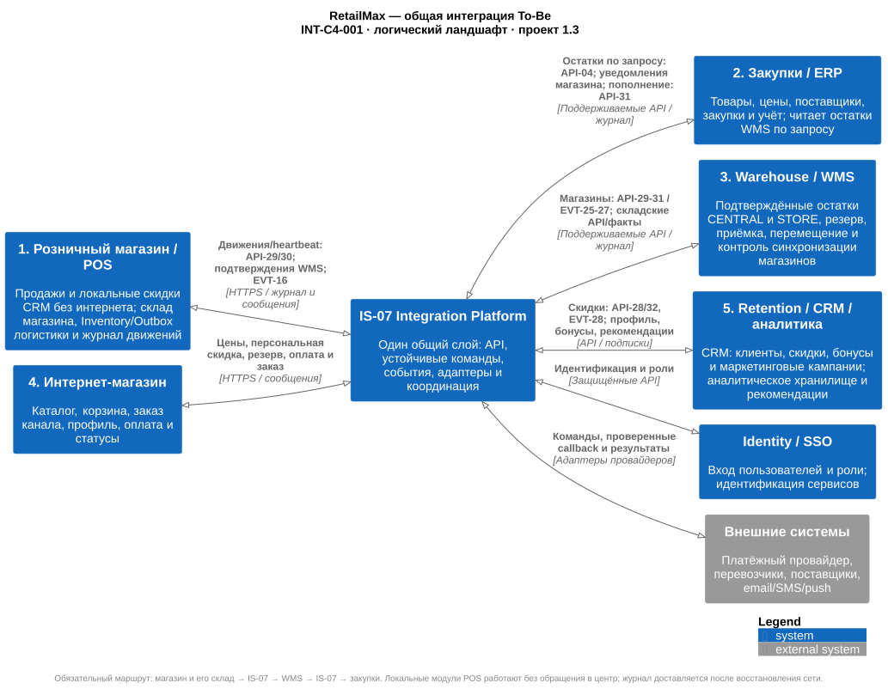

# RetailMax — общая модель интеграции To-Be

**Версия 1.0 · 12.11.2026 · Проект для межкомандного согласования**

Координатор проектирования: команда 4, интернет-магазин. Участники: продажи, закупки, склад, лояльность/аналитика, владельцы ERP/CRM и эксплуатация.

Все межсервисные обмены проходят через одну Integration Platform (IS-07): API для запросов и немедленных бизнес-подтверждений, устойчивые команды для отложенной работы, события для распространения уже совершившихся фактов. ERP, WMS и CRM сохраняют владение своими данными. Команды включают в собственные модели общие компоненты и идентификаторы контрактов из этого пакета.

Пакет развивает ADR-EC-001–004 и проект Warehouse. Он фиксирует конкретный предлагаемый вариант спорных стыков, но не означает согласия других команд или готовности API. Действующие As-Is и чужие ADR сохраняют свой статус.

## Что передать командам

1. [Модель работы и принятые в проекте границы](INT-001-target-model.md) — состав платформы, владельцы, сценарии, надёжность и ограничения.
2. [Каталог команд, событий и данных](INT-002-contract-catalog.md) — идентификаторы для стрелок на схемах, отправители, получатели и результаты.
3. [Изменения по командам и план перехода](INT-003-team-handoff.md) — что включить в C4/UML, требования и план работ; решения для совместного ревью.
4. [Сквозная приёмка](INT-004-acceptance.md) — проверяемые сценарии, отказоустойчивость и критерии готовности.
5. [HTML для просмотра и пересылки](output/RetailMax_Integration_ToBe.html) — документы и встроенные схемы без внешних ресурсов.

## Схемы

| Схема | Что показывает | Просмотр | Редактирование |
|---|---|---|---|
| INT-C4-001 | Общий ландшафт пяти доменов и внешних систем | [SVG](diagrams/INT-C4-001-landscape.svg) | [PlantUML](diagrams/INT-C4-001-landscape.puml) |
| INT-C4-002 | Логические контейнеры общей платформы | [SVG](diagrams/INT-C4-002-platform.svg) | [PlantUML](diagrams/INT-C4-002-platform.puml) |
| INT-C4-003 | Контейнеры интернет-магазина To-Be | [SVG](diagrams/INT-C4-003-ecommerce.svg) | [PlantUML](diagrams/INT-C4-003-ecommerce.puml) |
| INT-SEQ-001 | Оформление, оплата, удержание и исполнение заказа | [SVG](diagrams/INT-SEQ-001-online-order.svg) | [PlantUML](diagrams/INT-SEQ-001-online-order.puml) |
| INT-SEQ-002 | Поздний платёж, неизвестный результат и возврат | [SVG](diagrams/INT-SEQ-002-payment-recovery.svg) | [PlantUML](diagrams/INT-SEQ-002-payment-recovery.puml) |
| INT-SEQ-003 | Закупка, частичная приёмка и обновление остатка | [SVG](diagrams/INT-SEQ-003-procurement.svg) | [PlantUML](diagrams/INT-SEQ-003-procurement.puml) |
| INT-SEQ-004 | Офлайн-продажа, бонусы и аналитика | [SVG](diagrams/INT-SEQ-004-pos-loyalty.svg) | [PlantUML](diagrams/INT-SEQ-004-pos-loyalty.puml) |
| INT-DATA-001 | Источники данных и разрешённые проекции | [SVG](diagrams/INT-DATA-001-ownership.svg) | [PlantUML](diagrams/INT-DATA-001-ownership.puml) |

Для вставки в отчёт используйте SVG; для изменения — одноимённый `.puml`. Это логические модели: отдельный блок не требует отдельного микросервиса или нового кластера. INT-C4-001 — обзор ландшафта в нотации C4, INT-C4-002/003 — контейнерные представления; бизнес-сценарии раскрываются отдельно.

## Основания

- [DOC-05 — исходные интеграции](../00_Documentation/DOC-05.md), [DOC-06 — владельцы данных](../00_Documentation/DOC-06.md), [DOC-13 — принципы](../00_Documentation/DOC-13.md), [DOC-17 — NFR](../00_Documentation/DOC-17.md).
- [ADR интернет-магазина](../04_e-commerce_domain/05_Architecture_Decisions/README.md), [требования интернет-магазина](../04_e-commerce_domain/01_Business_Architecture/Requirements/requirements.md).
- [API Warehouse](../03_warehouse_domain/02_Application_Architecture/APIs/WH-API-001-catalog.md), [интеграции Warehouse](../03_warehouse_domain/02_Application_Architecture/Integrations/WH-INT-001-integration.md).
- [Сервисы продаж](../01_sales_domain/02_Application_Architecture/Integrations/INT-sales-services-interaction.md), [архитектура закупок](../02_purchasing_domain/02_Application_Architecture/architecture-design.md), [требования Retention](../05_retention_domain/01_business_context/Архитектурные_требования.md).
